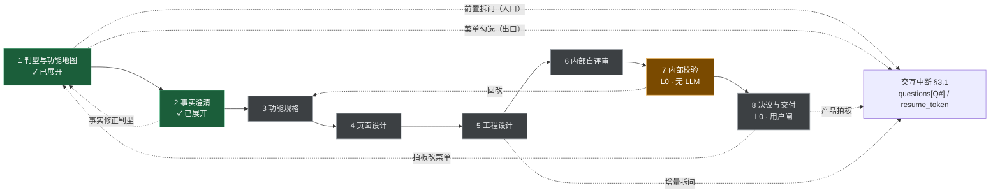

# ai-foundation-spec-chain · DESIGN

- 状态：**初版**（2026-09-08）｜**P1 设计修订**（2026-09-11，变更记录见 §8 末）
- 性质：本仓**唯一事实源**。改代码前先过本文；评审意见 / 变更先改 DESIGN 再动码。§ 编号与代码注释锚点一致（如 `DESIGN §3` = 运行体机制）。**当前尚无代码**，故 P1 期间 § 编号仍可调整（调整记入 §8 末）。
- 来源：由 `ai-foundation-memory/direction-spec-chain.md`（方向定稿）收敛而来；本文承载**具体设计**，方向文档只保留抽象与边界。

---

## §0 定位与边界

**定位**：AI Foundation 系列的**上游规格生产能力** = SDD（规范驱动开发）的**规范生产段**：把「一句话需求」经 authoring agent 收敛成 **spec 决策项文档族**。

**对下游 = 黑盒单能力**：只暴露「**一句话需求 → spec 设计**」；内部如何分段、如何编排不对外暴露。

**边界不变量**（不得违背）：
1. **规范性内容零偏好**（原「零具体产品名」，2026-09-11 修订）——机制类别（原子缓存类 / 任务队列类 / 周期调度类…）**必写、规范**；具体产品名**只许出现在「建议落地示例」标注内**（非规范、可等效替换）。判据见 §1.4。
2. **不读底座、自包含**——spec 不假设 / 不依赖任何具体底座存在；落地侧复用底座机制、冲突以底座等效为准。
3. **spec 按信息种类切**（func 三视图），不按执行者切。
4. **spec 文档族 + 生成面 CONTRACT = 消费端共享上下文**（不做按消费端的读权限）。
5. **校验内部化**——规格校验是本层产物的内部自检、不对外暴露。
6. **只对事实引导**——问用户只问可回答事实；AI 负责推导；不对用户抛方案选择题。

**上下游**：
- 上：**壳 + 人**（提供事实、做产品拍板）；
- 下：**生成面（bridge-mcp-server）**（读 spec 适配定参、生成骨架）——**规划中**（下游尚未实现读 spec 的逻辑，实测四仓零命中）/ **服务间契约整合层**（跨单元整合，另一立项）/ **消费端**（照 spec 实现）。

---

## §1 spec 文档族与 schema

### §1.1 文档族（产出，落目标项目 `specs/`）

| 文件 | 内容 | 真源地位 |
|---|---|---|
| req.md | 目标 / 角色 / 边界 / 场景 / 使用形态 / 部署场景 | — |
| func.md | 角色×业务事件×规则×**操作层**×页面功能单元 | **主真源**（操作层 = 公共锚） |
| pages.md | 页面设计（含真设计图）：每屏到可实现 | **页面细节真源**（字段冻结在此） |
| arch.md | 架构决策项 + 能力卡 + 结构（服务图/多仓布局）+ 部署形态 | — |
| data.md | 实体 / 关系 / 约束 / 存储取向 | — |
| api.md | 端点 + 权限 + 三向 trace | — |
| resolution.md | 决策项汇总 + 能力需求清单（`CAP#`）+ deferred / 拍板 | **生成面"能力 intake"的输入真源**——**规划**，下游未实现 |
| _log.md | 决策轨迹（过程资产，**不交付**） | — |

### §1.2 真源与 trace（防漂移）

- **func 为主真源**：其"操作层"（操作 ↔ 读写改的业务对象属性 ↔ 权限点）是页面 / 接口 / 数据的公共锚；**屏显示字段不在 func**（唯一真源在 pages 冻结）。
- **pages** = 页面细节真源；字段明细与筛选在此**冻结**，接口拆分照此落端点。
- **data 字段** = 各 pages 冻结字段的并集 + 操作层写入对象属性的归并。
- **resolution** = 喂生成面的决策清单（arch 的能力卡单向链接、不复制）。
- **trace 不复制**：跨文件只写指向（`→ func#操作`），不复制定义。

### §1.3 设计深度：三层承载

| 层 | 内容 | 归属 |
|---|---|---|
| ① 约束 / 不变式 | 原子 / 幂等 / 不超卖 / 不丢…（语义可判） | spec **必写** |
| ② 机制类别方案 + 敏感端点实现编排 + 量级退化路径 | 由量级 / 可靠性 / 时序事实推导 | spec **必写** |
| ③ **建议落地示例** | `redis`/MQ/组件等具体产品 | 落地侧从 ② 映射；**非规范**——可选写，须落在「建议落地示例」标注内、可等效替换；无依据时只写机制类别（§1.4） |

### §1.4 越界判据（C 分层 · 2026-09-11 修订）

规范性内容只写**机制类别**；具体产品名仅作**非规范**表达。

| 层 | 写法 | 规范性 |
|---|---|---|
| 机制类别 | 「需**原子缓存类**语义的扣减」 | **必写**、规范 |
| 建议落地示例 | 〔建议落地示例：redis / 等价原子缓存〕 | 可选、**非规范**、可等效替换 |

**确定性判据**（不经 LLM）：

1. 具体产品名**只许出现在**「建议落地示例」标注内——出现在其他地方即失败；
2. 标注体内出现**底座依赖词**（"本底座的 X""用底座的参数"）即失败。

**为什么**：spec 不携带技术栈档位偏好（档位以底座 selection 自省为唯一来源，见 §8 术语警示）；产品名本身即偏好泄漏——圈进显式非规范字段，规范内容保持零偏好。

**产品名 ≠ 业务事实**：`微信`（身份源）、某收款渠道（收款方）等作为**业务事实**出现时不受本条限制——它们是需求的组成部分，非技术选型。

**trace 判据**：方案与决策逐条 trace 到**用户事实或不变式**——trace 不上（纯工程偏好）不进 spec。

### §1.5 产物载体与形态（2026-09-11）

**可执行 = 本层验收标准**：拿到产物的执行者（当前 = **AI**）**无需回问任何业务问题、无需自行补充业务判断**，即可推进到生成 / 实现。

**消费者定位**：

| 消费者 | 定位 |
|---|---|
| **AI**（生成面 / 消费端 / 评审 agent） | **主消费者**，可执行性以此为准 |
| 人 | 后续——由 AI 产物经"人性化"派生；二者**同源**，可出不同版本 |

**载体主从**（据此反转早期"Markdown 为主"）：

| 载体 | 定位 |
|---|---|
| **机器可读形态** | **主形态**——交付真源，AI 直接消费 |
| Markdown | **派生**的面向人版本（可延后） |

**纪律**（沿用下游已验证模式）：`schema_version` + 严格校验 + **未知字段告警不丢弃**；spec 产物**必须落盘**（交付物，消费端要读）。

### §1.6 ID 体系：两层模型（2026-09-11）

**核心：系统内置词表 = 零。**

| 层 | 定义者 | 内容 | 校验 |
|---|---|---|---|
| **语法层** | 系统（内置、跨领域） | 前缀集、编号规则、引用语法、校验规则类型 | 正则 |
| **词汇层** | **资产（用户可维护）** | 域、决策维度、屏类别、枚举取值、角色名 | 查项目**自己的**词汇权威源 |

**命名空间（全部纯结构，与具体业务无关）**：

| 前缀 | 命名空间 | 定义处 |
|---|---|---|
| `RL` | 角色 | req.md |
| `E` | 业务事件 | func.md |
| `OP` | 操作层 | func.md |
| `R` | 业务规则 | func.md |
| `SCR` | 交互面 / 屏 | pages.md |
| `AX` | 架构决策项 | arch.md |
| `CAP` | 能力需求 | resolution.md |
| `ENT` | 数据实体 | data.md |
| `EP` | 端点 | api.md |
| `DF` / `AS` | deferred / 假设 | resolution.md |
| `Q` | 问题 | **运行期产生**，与 §3.1 `question_id` 同源 |
| `CR` | 校验判据（§5，元层） | 本 DESIGN |

**语法**：`<前缀><序号>`；序号 `[1-9][0-9]*`（无前导零、**不要求连续**、**分配即冻结**、删除留洞不复用）。

**关键推论：词汇不进 ID。** 域 / 维度 / 类别以**列**表达并引用资产（`R` + 域列，而非 `R-INV1`）。理由有二：①内嵌即把业务词汇写进 schema；②资产由用户维护，域码改名会使已冻结 ID 集体失效、引用漂移——**用户维护资产不该导致规格 ID 崩坏**。

**引用语法**：表格引用列裸写（`OP10/OP12`）；正文内嵌用反引号包裹（`` `R1` ``）——避开 CJK 词边界问题。

**语法正则**：

```text
\b(?:SCR|CAP|ENT|RL|EP|OP|AX|AS|DF|CR|E|Q|R)[1-9][0-9]*\b
```

前缀后必跟数字，故 `E1` 与 `EP1`、`R1` 与 `RL1` 天然无歧义，无需排序技巧。

**`CR5` 闭环边**（ID 体系的存在理由——没有可解析 ID，"trace 无孤儿"只是口号）：

| 边 | 要求 |
|---|---|
| `E` → `OP` | 每个业务事件 ≥ 1 个操作 |
| `OP` → `SCR` | 每个操作 ≥ 1 屏承载 |
| `EP` → `OP` | 每个端点 trace ≥ 1 个操作 |
| `EP` → `SCR` | 每个端点 trace ≥ 1 个页面字段 |
| `OP` → `ENT` | 每个写操作落到 ≥ 1 个数据实体 |
| `AX` → 事实 | 每个架构决策项有依据引用 |
| `CAP` → 事实 | 每条能力需求有支撑事实 + 量级升级触发 |

**校验分层**：语法层（正则 / 唯一性 / 前缀归属）**纯确定性**；词汇层（域 / 维度 / 类别是否存在）查项目**自己的**词汇权威源。两层共用一套规则，**不因载体不同而分叉**。

**词汇缺失时**由 §4.8 兜底补足——兜底条目在**本次运行内**计入词汇权威源（标记 `proposed`），跨项目共享前须经确认；**校验不因兜底而放松**。

### §1.7 待设计

- **schema 字段集**——**从运行反推**（2026-09-11 定为派生件）：先固化判据（§5），跑通最小闭环，再从跑通中长出字段集；不先写全再谈跑。
- **产物的机器可读格式选型**——载体形态与存储（§8）。

---

## §2 agent 运行体与工作流

### §2.1 形态

- **运行体内核**（工作流 / 状态 / 校验）+ 对外 **MCP 工具**（黑盒「一句话→spec」）；
- 内部节点**不对外分段**（分段是站在我们视角切、徒增下游负担）。

### §2.2 宏观抽象节点（8 个 · 概念层）

> **注意：这是宏观抽象，不是最终编排。** 每个宏观节点在具体设计中**可展开为多个子节点、且可能产生环**。

| # | 宏观节点 | 职责 | 产出 | 挂的机制 |
|---|---|---|---|---|
| 1 | 判型与功能地图 | 前置拆问补线索 → 判需求类型 → 推演功能地图 → 菜单给用户拍 | 前置问答 + 功能菜单 + 勾选（**均为初判态**） | 关系图谱（§4.3）；问题库「前置」相位（§4.2）；语义替换表（§4.4）；搜索（可选）；RAG（历史 spec） |
| 2 | 事实澄清 | 智能拆问 → 逐项收集事实 → **敏感点预判**（收敛后专项） | req.md（**唯一写入者**） | 智能拆问；问题库「澄清」相位；语义替换表；联网搜索；敏感点信号 |
| 3 | 功能规格 | 角色×事件×规则×操作层×页面功能单元 | func | 结构化提取；RAG（模板） |
| 4 | 页面设计 | 逐屏到可实现 **+ 真设计图** | pages | **视觉工具（内置）**；RAG（设计资产） |
| 5 | 工程设计 | 架构决策项/能力卡/结构/部署 + data/api；含**设计敏感点** | arch / data / api | 敏感点事实引导；搜索（可选）；RAG（自有） |
| 6 | 内部自评审 | 生成后自检（快、随生成走） | 评审意见（内部） | 规则检查；多 LLM 评审（演进） |
| 7 | 内部校验 | 规格完整性 / 可判 / 自包含 / trace 无孤儿（确定性） | 校验结果（内部） | **无（确定性，不经 LLM）** |
| 8 | 决议与交付 | resolution 汇总 + 用户拍板（只闸产品含义）+ 收尾 | resolution + 交棒 | 无（用户闸） |

### §2.3 具体编排（**进行中** · 本文档核心）

> 逐节点展开，统一格式：**输入 / 子节点（prompt 契约 + 后置校验）/ 闸 / 机制触发 / 回边 / 状态落点**。
> **进度**：节点 1–2 ✓ ｜ 节点 3–8 待展开。
> **prompt 全文**分节点备份在 [`docs/prompts/`](prompts/README.md)——DESIGN 只留**契约**（注入项 / 输出 schema / 规则要点 / 校验），全文回链该目录。

**总览**（绿＝已设计 ｜ 灰＝待展开 ｜ 黄＝无 LLM；虚线＝回边与闸。配色同时固定 `fill` 与 `color`，深色模式下仍可读）：



**三个用户闸共用同一套 §3.1 中断契约**（通则 ③）；`7 → 3` 的回改与 `5 → GATE` 的增量拆问为**占位**，随对应节点展开时落实。

#### §2.3.0 编排通则

**① LLM 三角色**（详见 §3.2）：**L0 无 LLM**（遍历 / 校验 / 闸）｜**L1 增强**（资产给候选与结构，LLM 筛选 / 排序 / 提案 / 措辞）｜**L2 主导**（LLM 生成，资产给锚点）。**兜底 = 资产缺失时 L1 降级为 L2**（§4.8），不设第四种角色。

**② 每个 LLM 步配确定性后置校验**——prompt 负责"生成得像"，校验负责"生成得对"。**凡校验不过即回问，不靠 LLM 自省。**

**③ 用户闸**：前置拆问（节点 1 入口）、菜单勾选（节点 1 出口）、产品拍板（节点 8）。

**④ 初判 → 验证 → 迭代**（贯穿）：

- 节点产出默认进 **`初判` 态**，带 `依据` 与 `待验证: [Q#]`，**不得静默当定案**；
- 事实验证通过 → 转 **`定案`**；被推翻 → **迭代**（回边重推）；
- **初判态产物一律落运行元数据，不写交付文件**——交付文件由**后续节点汇总时**写入。

**⑤ LLM 增强不越权**：可筛选 / 排序 / 提案 / 措辞，**不可决定**；提案标 `proposed` 且过用户闸（§2.4 硬边界 1、2）。

#### §2.3.1 节点 1 · 判型与功能地图

**输入**：一句话需求
**产出**：前置问答 ＋ 功能菜单 ＋ 勾选（**均为初判态**）
**挂的机制**：关系图谱（§4.3）／ 问题库「前置」相位（§4.2）／ 语义替换表（§4.4）／ RAG 历史 spec（§4.6）

**流程**：

| 步 | 角色 | 输入 → 输出 | 后置确定性校验 |
|---|---|---|---|
| 0 试提取 | L2 | 一句话 → 线索 + `missing` | 每条 `quote` 须为**原文字串** |
| 1 前置拆问 | L1 | `missing` → `questions[Q#]` | ① `Q#` ∈ 问题库「前置」条目 ② **问句不得含专业词**（语义替换表专业语侧黑名单） ③ ≤5 问 ④ 不与已答 `Q#` 重复 ⑤ 不与原话高度重叠 |
| 2 判型初判 | L1 | 线索 → 使用性质候选 + 依据 + `to_verify[Q#]` | ① 取值 ∈ 注入词表 ② `to_verify` ∈ 问题维度表 ③ **`to_verify` 不含已答 `Q#`** |
| 3 地图推演 | L1 | 判型 → 域/模块 + keep/drop 建议 + 提案 | ① 决策集 **== 闭包全集**（不漏不造） ② `reason` 非空 ③ **闭包自洽**（keep 子项则父域 keep） ④ 提案 `proposed=true` |
| 4 菜单生成 | L1 | 图 + 建议 → 可勾选菜单 | **菜单项集合 == 全集 ∪ 提案**（不多不少） |
| 5 用户闸 | L0 | 菜单 → 勾选结果 | — |

**prompt 契约**（注入项 + 输出 schema + 规则要点／**全文备份见 [`docs/prompts/node-01.md`](prompts/node-01.md)**）：

| 步 | 注入 | 输出 schema 要点 | 规则要点 |
|---|---|---|---|
| 0 | 无 | `{form_clues[], domain_clues[], missing[]}` | 只提取不推断；用**原词**；没说的写 null |
| 1 | 问题库「前置」条目、语义替换表 | `{questions[{question_id, ask, options[], why, free_text_ok}]}` | **大白话**、不冒专业词；≤5 问；**绝不问技术方案**；不问已说过的 |
| 2 | 图谱词表 + 典型特征、问题维度表 | `{candidates[{usage_nature, evidence[], confidence, to_verify[]}], proposed[]}` | 只从词表取值（缺则 `proposed`，**不硬套**）；`evidence` 指回线索原文；状态一律 `initial` |
| 3 | 图谱闭包全集、线索、判型、语义替换表 | `{decisions[{id, keep, reason, rank}], proposals[], notes}` | 只对全集 keep/drop、**不得增删**；**指不出依据即 drop**；**不做取舍**（keep ≠ 必须做） |
| 4 | keep 集、提案、RAG 命中 | `{groups[{domain, items[{id, label, desc, mvp, source, checked}]}]}` | 说明写"能做什么"非技术描述；`source` 必标；**不替用户勾选** |

**三个关键设计点**：

1. **菜单列全集**——`keep` 只决定**默认勾选与排序**，低相关项**折叠但可见、可勾回**。**AI 不自动加功能，也不偷偷减功能**（硬边界 1 的另一半）。
2. **`to_verify` 用 `Q#`**——让回边**可确定性判定**：答完直接比对，不需 LLM 猜要不要回退。
3. **前置拆问的产出即 §3.1 中断契约**——`status: needs_input` + `questions[question_id]` + `resume_token`；键空间 `Q#` 自此启用。

**前置拆问环（步 0 ⇄ 步 1）**：

```text
步0 试提取 ──missing 空──▶ 步2
   ▲
   │ missing 非空
   └──答案并入── 步1 拆问 ◀──┘
```

- **上限 2 轮**（依据既有纪律「追问两次不动 → 记假设」）；
- 达上限仍有 `missing` → **强制前进**，缺项记**假设**入 `_log`（**不阻塞运行**）；
- **防空转**：本轮 `Q#` 不得与**已答集**重复（校验 ④）；
- 轮次计数落元数据（续跑须知剩余轮次）。

**闸 1**（出节点 1）：① 判型有初判记录（依据 + `to_verify`，不静默定案）；② 勾选结果非空且每项 trace 到 `使用性质 / 域`；③ 菜单每项标了来源。→ 挂 `CR3`。

**回边**：

| 触发 | 回入点 | 增量约束 |
|---|---|---|
| 节点 2 答完 `to_verify`，**答案与初判冲突** | **步 2** 重跑，连带 3、4 重推 | 已有勾选**保留并标记差异**（失效 / 新增），**不得丢弃** |
| 答案与初判一致 | 不回边；`初判 → 定案`，记 `_log` | — |
| 节点 8 拍板改菜单 | **步 5** | 不重推地图，除非改了使用性质 |

**状态落点**（2026-09-11 修正——**节点 1 不写任何交付文件**）：

| 内容 | 落点 | 交付 |
|---|---|---|
| 线索 / 判型初判 / 功能地图 / 勾选结果 | **`.authoring.json` 初判索引** | 否（过程） |
| 达上限未补齐的缺口 | `_log.md`（记假设） | 否 |
| MVP 范围 → `req.md` | **节点 2 汇总时写入**（req 是节点 2 的产出） | — |
| 后置池 → `resolution.md` | **节点 8 写入**（决议文件） | — |

#### §2.3.2 节点 2 · 事实澄清

**输入**：节点 1 产出（勾选 + `to_verify[Q#]`）＋ 问题库「澄清」相位条目
**产出**：`req.md`（**本节点是唯一写入者**）
**挂的机制**：智能拆问 / 问题库 / 语义替换表 / 联网搜索

**流程**：

| 步 | 角色 | 输入 → 输出 | 后置确定性校验 |
|---|---|---|---|
| 0 汇集待问项 | L0 | 三路来源 → 合并去重、按依赖排序 | 同一 `Q#` 只出现一次 |
| 1 智能拆问 | L1 | 待问清单 → `questions[Q#]` | ① `Q#` ∈ 待问清单 ② **无专业词** ③ ≤5 问 ④ 不重复已答 ⑤ **依赖已满足**（`depends_on ⊆ 已答集`） ⑥ 不覆盖已知事实 |
| 2 事实归并 | L1 | `answers` → 结构化事实 | ① `source` ∈ 本轮提问集 ② `unresolved` 为真**不得**填具体值 ③ `followups` 维度 ∈ 维度表 |
| 3 收敛判定 | L0 | 待问清单空？ | 两段计数（见下） |
| 4 敏感点预判 | L1 | 功能清单 + 已收集事实 → 命中信号 + 应问基本面 | `hits[].evidence` 非空且 ∈ 功能项 id ∪ 事实键（**指不出依据即退回**） |
| 5 req 草拟 | L1 | 事实集 + 勾选 → `req.md` 各段 | 见闸 2 |
| — | **L0** | **闸 2** | — |

**步 3 收敛判定（两段式）**：

```text
步0 汇集 → 步1 拆问 ⇄ 步2 归并（通用段 ≤4 轮）
                ↓ 清单空
            步4 敏感点预判 ──并入待问清单──▶ 回步1（敏感点专项 ≤2 轮）
                ↓ 清单空 且 敏感点已判
            步5 req 草拟 → 闸2
```

**敏感点预判放在收敛之后**（2026-09-11 定），三个理由：

1. **事实充分才判得准**——信号（资源竞争 / 自动状态流转 / 价值对象…）需知业务全貌；
2. **一次专项而非打散**——敏感点问题集中成第二轮，用户感知是"先聊业务、再聊细节"；
3. **与节点 5 分工清晰**——节点 2 判**有哪些信号**（基于需求事实），节点 5 补**具体设计参数**（基于已定方案）。

**轮次上限分两段独立计数**：通用段 **4 轮** ／ 敏感点专项段 **2 轮**——共用一个预算会让长通用段饿死敏感点轮。达上限仍有未问项 → **强制前进**，剩余记假设入 `_log`。

**闸 2**：① 骨架必含段齐备（确定性）② 每段能 trace 到事实 **或** 显式"待定 + 触发条件"（确定性）③ 边界含 ≥1 排除项（确定性）④ 目标可验收（判断 · `CR2`）⑤ 无越界词（确定性 · `CR4`）。

**回边**：

| 触发 | 动作 |
|---|---|
| `to_verify` 答案**与节点 1 初判冲突** | 触发 §2.3.1 步 2 重跑（保留勾选、标记差异） |
| 节点 3 / 4 发现 req 缺事实 | 回**本节点步 1** 补问 |
| 节点 5 敏感点细节 | 复用**本节点步 1** 增量拆问 → 回改 `req.md` |

**状态落点**：事实集 / 待问清单 / 轮次 → `.authoring.json`（不交付）；**`req.md` → 目标项目 `specs/`（交付）**；未补齐缺口 → `_log.md`。

**prompt 契约**（注入项 + 输出 schema + 规则要点／**全文备份见 [`docs/prompts/node-02.md`](prompts/node-02.md)**）：

| 步 | 注入 | 输出 schema 要点 | 规则要点 |
|---|---|---|---|
| 1 | 待问清单、已知事实、语义替换表 | `{questions[{question_id, ask, options[], why, free_text_ok}]}` | 大白话、不冒专业词；≤5 问；**绝不问技术方案**；**依赖未满足不问** |
| 2 | QA 对、语义替换表 | `{facts[{dimension, value, source, quote, unresolved}], followups[]}` | 口语**规范化**但**保留原话**；答不上标 `unresolved`、**不编** |
| 4 | 功能清单、已收集事实、敏感点信号、四基本面 | `{hits[{signal, evidence[], ask_dimensions[]}], misses[]}` | 逐个信号判；**指不出依据即未命中**；**不猜方案** |
| 5 | 事实集、勾选、`req_skeleton` | `{sections[{name, content, traces[]}], open_questions[{question, trigger}]}` | 只写事实支撑得了的；无支撑写"待定 + 触发"；边界 ≥1 排除；目标**可验收**；不给技术方案 |

**问题库条目的两个字段**（2026-09-11 区分）：

- `触发条件` = **是否适用**——无触发则**永远不问**，记「默认关，触发=X」（§4.2）；
- `依赖` = **排序**——依赖未满足则**暂不问**，后续轮再问。

### §2.4 三条硬边界

1. **AI 不自动加功能**——功能清单来自图谱、由用户勾选；
2. **AI 不替用户做产品取舍**——产品含义 → 用户闸；工程内部 → AI 推导；
3. **确定性步骤不经 LLM**（§3.2 / §3.4）。

---

## §3 运行体机制

### §3.1 交互中断（B 基座 + A 增强）

- **B（基座 · 纯 MCP 续跑契约，非 skill）**：工具返回 `status: needs_input | done | failed` + `questions[question_id]`；壳 agent 转达用户、带 `resume_token` 续调。**不依赖壳服从、确定性落闸**：
  - 续调强校验：`resume_token` 有效 + `answers` 覆盖全部 `question_id` 且非空，不满足即 **fail-fast**；
  - `answers` 以 `question_id→answer` **结构化回传**（掐掉壳改写 / **代答**空间）；
  - tool description 与返回双写。
- **A（增强 · MCP elicitation）**：客户端支持则优先（协议级确定、稳定性保险）；不支持 → 回落 B。
- **skill 不作基座**（宿主专属，仅可选体验增强）。
- **dogfood 硬验证点**：跨壳跑同一任务，验 ①中间态正确转达 ②代答被闸挡 ③续跑可恢复。

### §3.2 LLM 适配层

- **配置项** = 外部 LLM（`url + sk`）+ `sampling` 开关；
- **选择 / 降级链**：sampling 开且壳支持 → 用 sampling（零配置）→ 壳不支持或 sampling 关 → `url + sk` → 皆不可用 → **fail-fast**；
- **能力基线只作「使用限制」声明、不作运行时探测**——我们只给参数与使用限制，**由人决定接什么壳 / 配什么模型**；
- **确定性步骤（校验 / 闸 / trace / 模板渲染 / copier 调用）不经 LLM**。

**LLM 三角色**（§2.3.0）：

| 角色 | 含义 | 资产的作用 |
|---|---|---|
| **L0 无 LLM** | 遍历 / 校验 / 闸 | 完整权威 |
| **L1 增强** | 资产给**候选与结构**，LLM 筛选 / 排序 / 提案 / 措辞 | **基准** |
| **L2 主导** | LLM 生成，资产给**锚点与约束** | **锚** |

**兜底 = 资产缺失时 L1 降级为 L2**（§4.8）——不是"资产 vs LLM"二选一，而是**同一职责的两档实现**。LLM 可筛选 / 排序 / 提案 / 措辞，**不可决定**（§2.3.0 ⑤）。

### §3.3 状态与中断恢复

- **状态 = 产物（spec 族，真源）+ 轻量运行元数据**（`specs/.authoring.json`：当前相位 / 待答问题 / `resume_token` / 产物完成标记 / 初判·验证索引），同放 `specs/`；
- **元数据不算交付物**（过程资产，同 `_log.md`，只服务中断恢复）；
- **恢复流程** = 读元数据拿相位与待答 → 读产物校验一致 → 继续；多任务以目录隔离。

### §3.4 确定性步骤清单（2026-09-11 由判据判定侧产出）

判据（§5.1）的判定侧划分即本清单：

| 判定侧 | 判据 |
|---|---|
| **纯确定性**（不经 LLM） | `CR4` 自包含、`CR5` 闭环无孤儿、`CR7` 可消费 |
| 纯判断（LLM） | `CR2` 可判 |
| 确定性 + 判断 | `CR1` 无空洞、`CR3` 有依据、`CR6` 敏感点已判 |

确定性部分的实现方式：正则 / 图遍历 / 结构校验。

---

## §4 资产

> **定位（2026-09-11）**：资产是**运行体的机制**（§2.2「挂的机制」列），**不是被读取的文件**。本层是 agent 运行体，**载体是后定的实现选择**。

| 资产 | 内容 | 能力定义 |
|---|---|---|
| 问题库 | 澄清用的问题类型结构（跨领域，非领域答案） | §4.2 |
| 模板族 | spec 文档骨架（templates） | §4.5（**结构待 §1.7**） |
| **关系图谱** | 节点 = 使用性质 / 域 / 模块；边 = 归属与关联 | §4.3 |
| **语义替换表** | 日常语 → 专业 / 业务语（"抢购"→"秒杀"） | §4.4 |
| RAG | 检索上述自有资产 | §4.6 |

### §4.1 共同契约（五项资产一体适用）

| 面 | 说明 |
|---|---|
| **能力** | 每项资产是一项**可被运行体调用的能力**，不是被读取的文件 |
| **消费相位** | 见 §2.2「挂的机制」列——资产只在对应宏观节点被调用 |
| **词汇出口** | 资产是 §1.6 **词汇层的权威源**——校验查这里；系统不内置任何词表 |
| **维护面** | 用户加节点 / 关系 / 词条 / 维度 = **加数据不加代码**；形态待评估（对话 / MCP 工具 / 编辑器） |
| **沉淀回路** | 运行中发现的缺口 → **候选条目**（proposed）→ **经用户确认**才转正式 |
| **零内置** | 系统不预置业务词汇；可随附**出厂种子**（可整份覆盖） |
| **缺失兜底** | 资产缺失（整项缺 / 条目未命中）时**由 LLM 兜底**，**不得中断运行**；兜底产物标为**候选**并进沉淀回路（§4.8） |

**沉淀必须设闸**的理由：**资产是跨项目共享的**。单次运行若不设闸直接写入，一个项目的怪词会污染后续所有项目。

**上一代产物**：`~/.claude/skills/authoring-spec/`（文本玩法，自称"测试版 v2"）及其 `resources/{templates,question-bank}.md`——**借鉴其设计，不继承其载体**。

### §4.2 问题库 · 澄清能力

**消费**：节点 2 事实澄清；其**架构 / 工程组维度**同时是 §1.6 词汇层「决策维度」的权威源。

| 面 | 内容 |
|---|---|
| 条目 | `Q#`（**= §3.1 `question_id`**）/ 所属组 / 消费相位 / **问什么**（维度要点）/ 决定哪些决策项 / 触发条件 / 追问维度 |
| 接口 | `候选问题(相位, 已收集事实)` → 命中项 + 未命中项（记「默认关，触发=X」，**不展开**） |
| 行为 | 运行体据**维度要点生成问话**（大白话，非照读模板）；一次 ≤5 问、聚焦当前相位；追问两次不动 → 记假设入 `_log` |
| 借上一代 | 六组（场景 / 业务 / 架构 / 页面 / 敏感点 / 工程）+ **触发型默认关** + 敏感点**四基本面** |

**关键**：资产存的是**维度结构**，不是问句文本——问句由运行体按上下文生成。这是它"跨领域、非领域答案"（§4 表）得以成立的原因。

**消费相位**（防重复问）：条目带 `相位`，运行体按相位取用、**同一维度不问两次**——

| 相位 | 消费者 | 内容 |
|---|---|---|
| **前置** | 节点 1 步 1 | 判型必需的场景维度（使用规模与同时性、业务敏感度…） |
| **澄清** | 节点 2 | 其余场景组 + 业务 / 架构 / 页面 / 敏感点 / 工程组 |
| **增量** | 节点 5 | 敏感点四基本面（取决于已定功能，此时才浮现） |

### §4.3 关系图谱 · 判型与功能地图能力

**消费**：节点 1；其**域 / 模块**同时是 §1.6 词汇层的权威源（`R` 的域列、`ENT` 归属等引用它）。

| 面 | 内容 |
|---|---|
| 结构 | 节点 = **使用性质 / 域 / 模块**；边 = **归属与关联** |
| 接口 | ① `判型(线索)` → 使用性质候选 + 依据 + `to_verify`（**L1：词表注入 + LLM 推理**）<br>② `闭包(域/模块)` → **候选全集**（确定性遍历）<br>③ `菜单(全集)` → 供勾选清单 |
| 闸 | **菜单列全集**——`keep` 只作**默认勾选与排序建议**，低相关项折叠但**可见可勾回**；**必须经用户勾选 / 拍板**（§2.4 硬边界 1、2）。**图谱保全集（不漏）、LLM 保相关（不臃肿）、校验保不越权** |
| 借上一代 | 无——上一代无对应物，属新增设计 |

**占位**：「使用性质」取值域**暂无依据**，先用占位（交易 / 协作 / 内容 / 工具 / 监控），待真实运行校准（§8）。

### §4.4 语义替换表 · 规范化能力

**消费**：节点 2；全局辅助。

| 面 | 内容 |
|---|---|
| 条目 | 日常语 ↔ 专业 / 业务语（`抢购` → `秒杀`）；带归属域、同义别名 |
| 接口 | ① **正查** `规范化(用户原话)` → 专业语（供规格书写、RAG 检索扩展）<br>② **反查** `降维(专业语)` → 大白话<br>③ 与图谱共用域键 |
| 借上一代 | 概念（`抢购→秒杀`）；载体不继承 |

**反查为新增用途**：既有材料只提正查，但 §2.4 要求"用大白话问"——没有反查就无法保证问话不冒专业词。

### §4.5 模板族 · 骨架能力

**消费**：节点 3（RAG 模板）。

| 面 | 内容 |
|---|---|
| 内容 | spec 文档骨架 |
| 接口 | `骨架(文件)` → 必含内容面；`校验(产物)` → 与骨架的一致性 |
| 依赖 | **被 §1.7 阻塞**——字段集未定前，只定"具备此项能力"，不定结构 |

### §4.6 RAG · 检索能力

**消费**：节点 1（历史 spec）/ 3（模板）/ 4（设计资产）/ 5（自有）。

| 面 | 内容 |
|---|---|
| 范围 | **只接自有资产**（问题库 / 图谱 / 替换表 / 模板 / 历史 spec / 设计资产）——**不接底座文档** |
| 接口 | `检索(查询, 范围)` → 相关条目 |
| 检索单元 | 各资产的**结构化条目**（非整篇文本），键由资产自定 |

### §4.7 载体

**待评估**：本地文档 vs 向量 / 知识图谱库。触发信号 = 资产规模使检索 / 遍历成为瓶颈，或"用户可自定义可维护"超出文件编辑能力。**定之前，实现不得被载体锁死。**

### §4.8 缺失兜底（2026-09-11 · 前提）

**资产缺失时不得中断运行——由 LLM 兜底。**

这条把资产从「运行的前提」降为「运行的**增益**」：**没有资产，运行体照样跑**（这正是上一代玩法 = 全兜底模式的形态）；资产的作用是让它**跑得更好、更稳、更可复用**，不是让它跑得起来。

| 情形 | 行为 |
|---|---|
| **整项资产缺失**（新项目、无出厂种子） | LLM 按本 DESIGN 的能力定义（§4.2–§4.6）**即时生成**该项资产的工作副本 |
| **条目未命中**（图谱无此域、问题库无此维度、替换表无此口语词） | LLM **即时补一条**，本次运行内即可用 |

**两级效力**：

| 层 | 效力 |
|---|---|
| **运行期** | 兜底条目**立即有效**——否则运行走不下去 |
| **资产层** | 同一条目仅作**候选（proposed）**，**经用户确认**才进入共享资产 |

**兜底 = 沉淀回路的触发器**：每次兜底都记一条缺口（未命中什么、LLM 补了什么、依据什么），这正是 §4 规则「未命中 / 反复出现的项沉淀回资产」的落地——**兜底一次 → 确认 → 资产长大 → 下次不再兜底**。资产就是这么长出来的。

**兜底不解除任何闸**：

- 图谱兜底出的功能菜单 / MVP 建议，**仍须用户勾选**（§4.3 闸、§2.4 硬边界 1、2）；
- 兜底产物**同样受 §5 判据约束**——尤其 `CR3`「有依据」：LLM 补的条目必须指得出依据，**否则是编造**，兜底不是免检通道。

---

## §5 校验与评审

### §5.1 校验判据（`CR1..CR7` · 2026-09-11）

判据判定的是**可执行性**（定义见 §1.5），**以 AI 为执行者**。

| ID | 判据 | 对 AI 的含义 | 判定侧 |
|---|---|---|---|
| `CR1` | **无空洞** | 无需回问即可推进（允许显式"待定"，但**必须带触发条件**） | 确定性 + 判断 |
| `CR2` | **可判** | 规则单义，不会实现出两种样子 | 判断 |
| `CR3` | **有依据** | 不必自行发明业务判断 | 确定性 + 判断 |
| `CR4` | **自包含** | 不必知道我们的底座 | **确定性** |
| `CR5` | **闭环无孤儿** | 任一元素都能找到配套 | **确定性** |
| `CR6` | **敏感点已判** | 不漏并发 / 时序 / 资金正确性 | 确定性 + 判断 |
| `CR7` | **可消费** | 无歧义读取 | **确定性** |

**可迭代纪律**：判据集带版本（`criteria_version`），产物记录"依据哪版判据产出"；**新增判据只对新产出生效**；收紧判据升版本，历史产物标记为旧版、**不自动重判、不阻断**；删除判据留档、不复用 ID。理由同 §1.6——**判据演进不应使已交付 spec 集体失效**。

**边界**：判据不管载体、不管字段集（schema 是判据的落地）、不管业务内容对错（§2.4 硬边界 2）。

### §5.2 三层校验

- **内部校验**（确定性）：`CR4` / `CR5` / `CR7`——**本层产物自检、不对外暴露**；
- **内部自评审**（子节点）：随生成走、保下限——承担 `CR1` / `CR2` / `CR3` / `CR6` 的判断部分；
- **独立评审 agent**（外部，另一事项）：消费**任意**设计规格的质量检测、可归档 / gate（与 `ai-foundation-review` 精神同构）；**演进：并行多 LLM 评审**。**P1 阶段用于扮演"可执行的消费端"做盲测**（§7）。

---

## §6 MCP 面

- **resource**：玩法素材 / spec 模板；
- **tool**：**authoring 运行体**（黑盒「一句话→spec」）；
- **校验内部化**（不作 tool 暴露）；
- **面分离**：与生成面 `bridge-mcp-server` 分开、各自演进；
- **暴露协议**：MCP 与 A2A 并存（**当前仅 MCP**；A2A 为能力服务化 / 跨运行时委派场景，状态在文件 → 任务与状态解耦，A2A 化无需重构内核）。

---

## §7 分阶段落地

- **P0**：仓骨架 + CLAUDE.md 收编 + 本 DESIGN；
- **P1**：判据固化（§5.1）✓ → ID 体系（§1.6）✓ → 资产能力定义（§4）✓ → **具体编排**（§2.3，节点 1–2 ✓）→ **最小闭环跑一次**（产出端 + 独立 agent 盲测 + 人审核）→ 从跑通**反推** schema 字段集（§1.7）；
- **P2**：agent 运行体——具体编排（§2.3）+ 交互中断（§3.1）+ LLM 适配（§3.2）+ 状态（§3.3）；
- **P3**：MCP 面（§6）+ dogfood（积分 / 商城）；
- **P4**：回喂 / 沉淀（资产、底座）。

---

## §8 未决 / 待设计项

1. **agent 具体编排**（§2.3）——**进行中**：通则 ✓ + 节点 1 ✓，节点 2–8 待展开；
2. **spec schema 字段集**（§1.7）——**从运行反推**，待最小闭环跑通；
3. **资产载体选型**（§4.7）——本地文档 vs 向量 / 知识图谱库，**一步一步评估**（能力与接口已定，见 §4.1–§4.6）；**关系图谱「使用性质」取值域**暂无依据，先用占位（§4.3）；
4. **产物的机器可读格式选型**（§1.5 / §1.7）；
5. **壳侧续跑契约的具体 schema**（§3.1 字段约定细化）——键空间 `Q#`（§1.6）已就位；
6. （另一立项）**服务间契约整合层**——规则库 + 跨单元整合，见 `ai-foundation-memory/direction-spec-chain.md`。

**已解决（原未决项）**：运行体确定性步骤清单 → §3.4（由判据判定侧划分产出）。

### 变更记录

- **2026-09-11 · P1 设计修订**：
  1. 越界判据改 **C 分层**（§0-1 / §1.3 / §1.4），标注定名「**建议落地示例**」，附两条确定性判据；
  2. 新增 **§1.5 产物载体与形态**——「可执行」定义 + AI 为主消费者 + **机器可读为主形态**（反转早期"Markdown 为主"）；
  3. 新增 **§1.6 ID 体系两层模型**——语法层系统内置 / 词汇层资产注入，**词汇不进 ID**；
  4. §4 明确**资产是运行体机制、非文件**，载体待评估；skill 属**上一代载体**（借鉴设计不继承载体）；
  5. §5 落 **`CR1..CR7` 判据** + 版本纪律（只对新产出生效、不追溯）；
  6. §3.4 由判据判定侧**产出**（原待设计项关闭）；
  7. **§4 展开为能力定义**——§4.1 共同契约 + §4.2–§4.6 五项资产的条目 / 接口 / 闸 / 借上一代 + §4.7 载体；新增**沉淀设闸**（候选条目经用户确认）、**语义替换表反查**（服务"只对事实引导"）；
  8. 新增 **§4.8 缺失兜底**——**资产缺失时由 LLM 兜底、不得中断运行**；兜底条目**运行期即时有效 / 资产层仅作候选**（两级效力）；兜底即沉淀回路的触发器；**兜底不解除任何闸**（用户闸、§5 判据）。据此资产从「运行的前提」降为「运行的**增益**」；
  9. **§2.3 具体编排启动**——§2.3.0 编排通则（LLM 三角色 / 确定性后置校验 / 三个用户闸 / **初判→验证→迭代** / 增强不越权）+ §2.3.1 **节点 1 完整设计**（步 0–5、prompt 契约、**前置拆问环上限 2 轮**、**菜单列全集**、回边、状态落点）。同步：§3.2 补 LLM 三角色；§2.2 节点 1 行修订；§4.2 补**消费相位**（前置 / 澄清 / 增量）；§4.3 接口与闸改按「**图谱保全集 / LLM 保相关 / 校验保不越权**」。**节点 1 不写任何交付文件**（req 归节点 2、resolution 归节点 8）。
  10. **§2.3.2 节点 2 · 事实澄清**——步 0–5（汇集 / 拆问 / 归并 / 收敛 / **敏感点预判** / req 草拟）+ 闸 2 + 回边 + 状态落点。要点：**两段式轮次**（通用段 4 轮 ／ 敏感点专项 2 轮，**独立计数**——共用预算会让长通用段饿死敏感点轮）；**敏感点预判放在收敛之后**（事实充分才判得准 / 集中成专项轮 / 与节点 5 分工清晰：本节点判*有哪些信号*、节点 5 补*具体设计参数*），其产出**并入待问清单、重新打开已收敛的循环**；问题库条目区分 **`触发条件`（是否适用）** 与 **`依赖`（排序）**；`req.md` 由本节点**唯一写入**。§2.2 节点 2 行同步；prompt 全文见 [`docs/prompts/node-02.md`](prompts/node-02.md)。
- **§ 编号**：新增 §1.5–§1.7（原 §1.5 待设计项并入 §1.7）。当前尚无代码，锚点无影响。

**术语警示（2026-09-11）**：本层早期用的「生成面 **selection 自省**」**已改称「能力 intake」**——避免与下游**已实现**的 `selection` 混淆（后者指底座 `params.json` 的策展区，字段仅 `suited_for`/`tradeoffs`，是**技术栈事实**；见 `fullstack-param-protocol/SCHEMA.md` 的 S3 定案）。二者方向相反：本层 spec **不携带**技术栈档位偏好。
