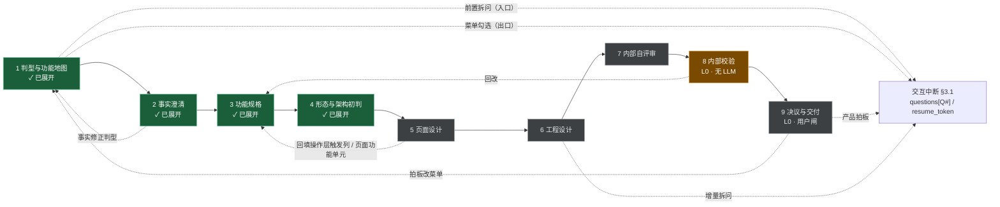

# ai-foundation-spec-chain · DESIGN

> ## ⛔ 本项目已停止（2026-09-15）
>
> **本文不再是"待实现的设计"，而是一份"已被否决的设计"。** 请先读 **[EVALUATION.md](EVALUATION.md)**（为什么停、沿途实测、留下的判据）。
>
> - **保留本文的理由**：它记录了这条路上**每一步的推演**，以及**沿途的一手调研与实测数字**。对任何"想再做一次上游规格生产"的人，这是**避免重走一遍的负结果档案**。
> - **阅读方式**：把它当作**反例集**读，不要当作蓝图。下文所有"应当""将要"的表述，**均已停止**。
> - **一句话结论**：反复尝试的每一种形态（全链 / 页面设计 / 接口设计 / 架构设计 / 骨架图 / 审查器 / 需求收集助手 / 清单访谈），都在抢同一个生态位——**「独立于对话与代码的中间产物」**。而这个生态位是空的：**它比记忆重，比代码旧。**

- 状态：**初版**（2026-09-08）｜P1 设计修订（2026-09-11）｜**已停止**（2026-09-15，见上）
- 性质：本文原定为**唯一事实源**。改为：本设计**已停止**，现存价值是**负结果档案**；事实源转为 [EVALUATION.md](EVALUATION.md)。
- 来源：由 `ai-foundation-memory/direction-spec-chain.md`（方向定稿）收敛而来；本文承载**具体设计**，方向文档只保留抽象与边界。

---

## §0 定位与边界

**定位**：AI Foundation 系列的**上游规格生产能力** = SDD（规范驱动开发）的**规范生产段**：把「一句话需求」经 authoring agent 收敛成 **spec 决策项文档族**。

**对下游 = 黑盒单能力**：只暴露「**一句话需求 → spec 设计**」；内部如何分段、如何编排不对外暴露。

**边界不变量**（不得违背）：
1. **规范性内容零偏好**（原「零具体产品名」，2026-09-11 修订）——机制类别（原子缓存类 / 任务队列类 / 周期调度类…）**必写、规范**；具体产品名**只许出现在「建议落地示例」标注内**（非规范、可等效替换）。判据见 §1.4。
2. **不读底座、自包含**——spec 不假设 / 不依赖任何具体底座存在；落地侧复用底座机制、冲突以底座等效为准。
3. **spec 按信息种类切**（func 三视图），不按执行者切。
4. **spec 文档族 + 生成面 CONTRACT = 消费端共享上下文**（不做按消费端的读权限）。
5. **校验内部化**——规格校验是本层产物的内部自检、不对外暴露。
6. **只对事实引导**——问用户只问可回答事实；AI 负责推导；不对用户抛方案选择题。

**上下游**：
- 上：**壳 + 人**（提供事实、做产品拍板）；
- 下：**生成面（bridge-mcp-server）**（读 spec 适配定参、生成骨架）——**规划中**（下游尚未实现读 spec 的逻辑，实测四仓零命中）/ **服务间契约整合层**（跨单元整合，另一立项）/ **消费端**（照 spec 实现）。

---

## §1 spec 文档族与 schema

### §1.1 文档族（产出，落目标项目 `specs/`）

| 文件 | 内容 | 真源地位 |
|---|---|---|
| req.md | 目标 / 角色 / 边界 / 场景 / 使用形态 / 部署场景 | — |
| func.md | 角色×业务事件×规则×**操作层**×页面功能单元 | **主真源**（操作层 = 公共锚） |
| pages.md | 页面设计（含真设计图）：每屏到可实现 | **页面细节真源**（字段冻结在此） |
| arch.md | 架构决策项 + 能力卡 + 结构（服务图/多仓布局）+ 部署形态 | — |
| data.md | 实体 / 关系 / 约束 / 存储取向 | — |
| api.md | 端点 + 权限 + 三向 trace | — |
| resolution.md | 决策项汇总 + 能力需求清单（`CAP#`）+ deferred / 拍板 | **生成面"能力 intake"的输入真源**——**规划**，下游未实现 |
| _log.md | 决策轨迹（过程资产，**不交付**） | — |

### §1.2 真源与 trace（防漂移）

- **func 为主真源**：其"操作层"（操作 ↔ 读写改的业务对象属性 ↔ 权限点）是页面 / 接口 / 数据的公共锚；**屏显示字段不在 func**（唯一真源在 pages 冻结）。
- **pages** = 页面细节真源；字段明细与筛选在此**冻结**，接口拆分照此落端点。
- **data 字段** = 各 pages 冻结字段的并集 + 操作层写入对象属性的归并。
- **resolution** = 喂生成面的决策清单（arch 的能力卡单向链接、不复制）。
- **trace 不复制**：跨文件只写指向（`→ func#操作`），不复制定义。

### §1.3 设计深度：三层承载

| 层 | 内容 | 归属 |
|---|---|---|
| ① 约束 / 不变式 | 原子 / 幂等 / 不超卖 / 不丢…（语义可判） | spec **必写** |
| ② 机制类别方案 + 敏感端点实现编排 + 量级退化路径 | 由量级 / 可靠性 / 时序事实推导 | spec **必写** |
| ③ **建议落地示例** | `redis`/MQ/组件等具体产品 | 落地侧从 ② 映射；**非规范**——可选写，须落在「建议落地示例」标注内、可等效替换；无依据时只写机制类别（§1.4） |

### §1.4 越界判据（C 分层 · 2026-09-11 修订）

规范性内容只写**机制类别**；具体产品名仅作**非规范**表达。

| 层 | 写法 | 规范性 |
|---|---|---|
| 机制类别 | 「需**原子缓存类**语义的扣减」 | **必写**、规范 |
| 建议落地示例 | 〔建议落地示例：redis / 等价原子缓存〕 | 可选、**非规范**、可等效替换 |

**确定性判据**（不经 LLM）：

1. 具体产品名**只许出现在**「建议落地示例」标注内——出现在其他地方即失败；
2. 标注体内出现**底座依赖词**（"本底座的 X""用底座的参数"）即失败。

**为什么**：spec 不携带技术栈档位偏好（档位以底座 selection 自省为唯一来源，见 §8 术语警示）；产品名本身即偏好泄漏——圈进显式非规范字段，规范内容保持零偏好。

**作用域**（2026-09-11 修正）——本条**不是无差别的全局规则**，它只约束"技术实现"类内容：

| 层 | 内容 | 受本条约束？ |
|---|---|---|
| **视觉设计** | 布局 / 控件形态 / 颜色 / 间距 / 字排 / 密度 | ❌ **不受**——它是**视觉产品本身**，可具体、**应具体** |
| **实现技术** | 框架 / 组件库 | ✅ 受——零产品名（`React` / `Antd` / `Tailwind` 不落 spec） |
| **后端机制** | 缓存 / 队列 / 调度 | ✅ 受——机制类别必写，产品名只许出现在「建议落地示例」内 |

**为什么视觉设计不受约束**：页面设计**是视觉产品**，不具体才叫不合格。把技术选型的约束无差别套到视觉层，会让 `pages.md` 无法执行（违反 `CR1` 无空洞）。**「不写组件库名」（如 `Antd`）仍然成立**——那属**实现技术**层。

**产品名 ≠ 业务事实**：`微信`（身份源）、某收款渠道（收款方）等作为**业务事实**出现时不受本条限制——它们是需求的组成部分，非技术选型。

**trace 判据**：方案与决策逐条 trace 到**用户事实或不变式**——trace 不上（纯工程偏好）不进 spec。

### §1.5 产物载体与形态（2026-09-11）

**可执行 = 本层验收标准**：拿到产物的执行者（当前 = **AI**）**无需回问任何业务问题、无需自行补充业务判断**，即可推进到生成 / 实现。

**消费者定位**：

| 消费者 | 定位 |
|---|---|
| **AI**（生成面 / 消费端 / 评审 agent） | **主消费者**，可执行性以此为准 |
| 人 | 后续——由 AI 产物经"人性化"派生；二者**同源**，可出不同版本 |

**载体主从**（据此反转早期"Markdown 为主"）：

| 载体 | 定位 |
|---|---|
| **机器可读形态** | **主形态**——交付真源，AI 直接消费 |
| Markdown | **派生**的面向人版本（可延后） |

**纪律**（沿用下游已验证模式）：`schema_version` + 严格校验 + **未知字段告警不丢弃**；spec 产物**必须落盘**（交付物，消费端要读）。

### §1.6 ID 体系：两层模型（2026-09-11）

**核心：系统内置词表 = 零。**

| 层 | 定义者 | 内容 | 校验 |
|---|---|---|---|
| **语法层** | 系统（内置、跨领域） | 前缀集、编号规则、引用语法、校验规则类型 | 正则 |
| **词汇层** | **资产（用户可维护）** | 域、决策维度、屏类别、枚举取值、角色名 | 查项目**自己的**词汇权威源 |

**命名空间（全部纯结构，与具体业务无关）**：

| 前缀 | 命名空间 | 定义处 |
|---|---|---|
| `RL` | 角色 | req.md |
| `E` | 业务事件 | func.md |
| `OP` | 操作层 | func.md |
| `R` | 业务规则 | func.md |
| `SCR` | 交互面 / 屏 | pages.md |
| `AX` | 架构决策项 | arch.md |
| `CAP` | 能力需求 | resolution.md |
| `ENT` | 数据实体 | data.md |
| `EP` | 端点 | api.md |
| `DF` / `AS` | deferred / 假设 | resolution.md |
| `Q` | 问题 | **运行期产生**，与 §3.1 `question_id` 同源 |
| `CR` | 校验判据（§5，元层） | 本 DESIGN |

**语法**：`<前缀><序号>`；序号 `[1-9][0-9]*`（无前导零、**不要求连续**、**分配即冻结**、删除留洞不复用）。

**关键推论：词汇不进 ID。** 域 / 维度 / 类别以**列**表达并引用资产（`R` + 域列，而非 `R-INV1`）。理由有二：①内嵌即把业务词汇写进 schema；②资产由用户维护，域码改名会使已冻结 ID 集体失效、引用漂移——**用户维护资产不该导致规格 ID 崩坏**。

**引用语法**：表格引用列裸写（`OP10/OP12`）；正文内嵌用反引号包裹（`` `R1` ``）——避开 CJK 词边界问题。

**语法正则**：

```text
\b(?:SCR|CAP|ENT|RL|EP|OP|AX|AS|DF|CR|E|Q|R)[1-9][0-9]*\b
```

前缀后必跟数字，故 `E1` 与 `EP1`、`R1` 与 `RL1` 天然无歧义，无需排序技巧。

**`CR5` 闭环边**（ID 体系的存在理由——没有可解析 ID，"trace 无孤儿"只是口号）：

| 边 | 要求 |
|---|---|
| `E` → `OP` | 每个业务事件 ≥ 1 个操作 |
| `OP` → `SCR` | 每个操作 ≥ 1 屏承载 |
| `EP` → `OP` | 每个端点 trace ≥ 1 个操作 |
| `EP` → `SCR` | 每个端点 trace ≥ 1 个页面字段 |
| `OP` → `ENT` | 每个写操作落到 ≥ 1 个数据实体 |
| `AX` → 事实 | 每个架构决策项有依据引用 |
| `CAP` → 事实 | 每条能力需求有支撑事实 + 量级升级触发 |

**校验分层**：语法层（正则 / 唯一性 / 前缀归属）**纯确定性**；词汇层（域 / 维度 / 类别是否存在）查项目**自己的**词汇权威源。两层共用一套规则，**不因载体不同而分叉**。

**词汇缺失时**由 §4.8 兜底补足——兜底条目在**本次运行内**计入词汇权威源（标记 `proposed`），跨项目共享前须经确认；**校验不因兜底而放松**。

### §1.7 待设计

- **schema 字段集**——**从运行反推**（2026-09-11 定为派生件）：先固化判据（§5），跑通最小闭环，再从跑通中长出字段集；不先写全再谈跑。
- **产物的机器可读格式选型**——载体形态与存储（§8）。

### §1.8 页面设计的形态（2026-09-11 · **2026-09-15 已实测**）

> 本节在节点 5 的具体设计**之前**先定**形态**。**两个待决项已于 2026-09-11 定**（导出目标 / token 格式，见下）。
> **形态已于 2026-09-15 用 demo 实测**（值班表换班 3 屏；渲染器 = json-render + 现成 shadcn 目录）：**成立**。实测报告见 [`demo/REPORT.md`](../demo/REPORT.md)。下文标「**实测**」处即该报告的结论回写。

**形态：两层**（2026-09-15 **实测改画**——原画作"三层"，错在哪见下）：

| 层 | 内容 | 谁写 |
|---|---|---|
| **页面语义描述** | 只含语义（区块 / 语义控件 / 字段 / 状态 / 交互），**不含任何视觉决策** | **我们写**（业务知识） |
| **映射层** | 语义件 → **UI 原语**组件树（如「数据表格」拆成 表头行 / 数据行 / 单元格 / 行内操作） | **我们写**（L0 纯函数） |
| **渲染器 + 原语目录 + token** | 组件树 → 可视页面；视觉由 token 驱动 | **现成** |

> **实测改画的原因**：原设计把中间层写成「catalog = **语义词表**（数据表格 / 表单 / 详情…）→ 组件实现，**我们写薄封装**」。
> 实际上现成渲染器的 catalog 提供的是 **UI 原语**（Card / Stack / Grid / Button / Table / Input…），**根本没有「数据表格」「表单」这类语义件**。
> 于是「语义件 → 原语组合」的全部知识**压在映射层**——原设计里那层"薄封装"是**空的**（实测**自建组件 0 个**，宿主 217 行全是装配）。
> 结论：**成本量级不变（仍是那 200–400 行），但归属的那一层画错了**——它属于映射层，不属于 catalog。

**四条关键性质**：

1. **语义描述不含视觉决策**——布局用「**模式**」不用「**位置**」：`主从` / `列表页` / `分步` / `看板`，而非"左列表右详情"。〔外部佐证：A2UI 的 `usageHint` 是**语气**不是字号〕

   > ⚠️ **实测修正（2026-09-15）**：原句后半是「宽屏左右分栏、窄屏堆叠**是渲染器的决定**」——**不成立**。
   > 实测窄屏（420px）下 `Grid(columns=N)` **不重排**，只是把 N 列挤在一起、文字折行。
   > **渲染器决定「怎么画」，不负责「重新编排」。** 窄屏降级（如"窄屏用卡片列表代替表格"）是**映射层或 catalog 的责任，必须显式给出**。
   > 这条不改变性质 1 的目的（语义件不写位置），但它**划掉了"响应式自动就有"这个隐含假设**。
2. **视觉设计 ≠ 具体实现**（§1.4 作用域）——组件库属**实现层**，**不受**零产品名约束；只要它不出现在产物里。
3. **映射层是纯函数**（L0，确定性、可单测）：`render(屏) → 组件树`。
4. **真设计图 = 确定性渲染**——同输入同输出、可回归、不撒谎。

**要写什么（成本）** —— **2026-09-15 实测**（3 屏 / 79 个元素）：

| 部分 | 估 | **实测** |
|---|---|---|
| 语义件映射（7–10 个） | 200–400 行 | 7 个语义件 **199 行** |
| 字段类型渲染器（~10 种） | 100–200 行 | 7 种 **83 行** |
| 布局模式（~5 种） | 50–100 行 | 3 种 **27 行** |
| 交互绑定 + 错误处理 | 50–100 行 | **51 行** |
| 组件树构造 + catalog 消费 + 编排 | （原未单列） | **197 行** |
| **合计** | **~400–800 行** | **560 行**（核心 519 + CLI 32） |

**宿主（装配）另计 217 行**——catalog 声明 / registry / 导航 / 状态 / 入口 / Tailwind 主题。
**估算准确**：落在原区间内，且**没有出现"估算外"的隐藏成本**。

**现成、不用写的**：渲染器 / tree-walk / 消息处理 / 状态绑定 / **组件实现** / 主题。
→ **实测自建组件 0 个**；「不写渲染器」这一条**完全成立**。

**复杂度不随项目增长**——新项目加的是**字段类型与语义件的数据**，不是新代码。这是它可接受的关键。

**交互（三层）**：

| 层 | 内容 | 状态 |
|---|---|---|
| **动作** | 屏上元素 → 绑哪个 `OP#` | ✅ 已有（「承载操作」列） |
| **结果** | `on_success: {goto: SCR#}` ／ `on_failure: [{when: R#, feedback, target}]` | **2026-09-11 新增** |
| **演示** | 多状态静态图 + **可点原型** | 派生 |

**「结果」补上了 `CR5` 的 `OP → SCR` 边**——原先只有半条（证明了"按钮存在"，没证明"操作完整"）。**可点原型做**：跳转关系已结构化，编成切换即可。**实测：成立**——行内按钮跳屏、表单填值、成功跳转带值、失败留屏出提示、取消返回，端到端 5/5 全过。

> **实测机制**（2026-09-15）：`on_failure` 的落地方式是「**宿主只抛规则号 + 映射层声明反馈**」——
> 宿主 `throw new Error('R1')`（**不写 state、不写措辞**）；映射层生成
> `onError: {set: {"/<屏>/failure": "$error.message"}}`（`$error.message` 是渲染器的魔值，取异常 message），
> 并在树里为**每条失败规则**放一个 `Alert` + `visible: {$state: "/<屏>/failure", eq: "R1"}`，**按 `target` 锚到对应字段下方**。
> 于是「结果」层**完全声明在映射层**，宿主零业务措辞。

**实测暴露的三条新记录**（2026-09-15，详见 [`demo/REPORT.md`](../demo/REPORT.md)）：

| # | 记录 | 处置 |
|---|---|---|
| 1 | **`children` 在渲染器 schema 里必填**，而 TS 类型标为可选。首轮三屏**全部校验失败** | **纪律**：组件树一律以**校验器**为准，不以类型标注为准——这正是「校验负责生成得对」的用例 |
| 2 | **失败分支的约定是隐式的**：靠"宿主抛出的 message 恰好是规则号"连接 `$error.message` 与 `visible` 条件。宿主哪天抛个中文错误信息，`visible` 永远不成立，**且静默** | **待补**：节点 5 编排时要给这条约定加**确定性校验**（失败反馈的规则号 ∈ 规格声明的 `R#`） |
| 3 | **跨屏数据流需要显式建模**（原设计未提）。结果页要显示"用户刚提交的值"需两件事：① 各屏**共用一个 store**；② 语义件要区分**样例数据**与**提交上来的值**（实测用 `value_from: "submission.F-XX"`，映射层解析成"承载该字段那一屏的表单状态路径"） | **纳入**节点 5：语义件 schema 需要"数据来源"的分类（样例 / 运行时） |

**真设计图的导出目标 = HTML**（2026-09-11 定）：渲染器产出的 **HTML 就是目标产物**，不另求外部载体。可点原型、多状态预览都在这一份 HTML 里。

**不另立新仓：渲染链路全部落在本仓**（2026-09-11 改定）：

| 过程 | 归谁 |
|---|---|
| 页面语义描述 | 本仓（spec 产物） |
| **语义件 → 组件树**（映射层） | **本仓** |
| 组件实现（原写 "catalog 薄封装"） | **第三方现成**——实测自建 **0 个**：现成原语目录下，原设想的薄封装层**不存在** |
| 组件树 → HTML（渲染接入）＋ DTCG → CSS 变量 | **本仓** |

- **原「独立成仓」的两个动因都不成立**：① **技术栈不同**——按本节设计，我们写的部分是**胶水代码**（映射 + 装配），没有"真前端"的复杂度；② **可独立演进**——**太薄**，立一个仓的维护成本与价值不成比例。
- **渲染器本身是第三方依赖**，不是我们写的。落在本仓的只有**映射层**与**渲染装配**（实测：映射 560 行 + 宿主 217 行）——因此本仓会包含少量前端代码。
- **连带**：§2.2 节点 5 的「视觉工具（**内置**）」**维持不变**——它本来就是内置的。
- **退化**：渲染不可用时**只出规格、不出图**——spec **不因工具缺席而残缺**（渲染产物是派生，§1.5）。

**组件树是层间接口**（不是跨仓契约）：即使不跨仓，它仍是**我们的映射层**与**第三方渲染器**之间的接缝。故仍按接口的标准对待——**独立位置、机器可读 schema、确定性校验器 + 正反例 fixtures、带 `schema_version`**（同 §1.6 / §5.1 的一贯纪律）。

> **实测（2026-09-15）**：确定性校验器**可直接复用渲染器自己的** `catalog.validate(spec)`——它就是这份接缝的 schema 权威，不必自己再写一份。
> 实测中它**抓到了真缺陷**（见上表记录 1）。`schema_version` 目前仍是**摆设**（无兼容性策略）——列为未验证项。
>
> **独立成仓的判据**（2026-09-11 记，对协议仓同样适用）：**有多个独立消费方，或存在真正的技术栈隔离**。组件树两个都不满足。若将来满足（第二种渲染目标 / 别的 spec 生产方），**整体搬出即可，不重构**。
> 系列先例：`params.json` / `selection` 多消费方 → 独立成 `fullstack-param-protocol`；桥与底座间的 `CONTRACT.md.jinja` 单消费方 → 留在 `fullstack-bridge/combos/`。

**Figma 暂不引入**——理由是**外部依赖与工程门槛**（Full seat / MCP Catalog 白名单 / beta 品质），**不是**定位冲突（§1.4 作用域修正后那条论据已作废）。「渲染进 Figma」降为**可选导出器**（下游自选，**非本层职责**）。

**视觉 token 层格式 = DTCG**（2026-09-11 定）：采用 **DTCG 2025.10**。转换用 Terrazzo（MIT）或等价工具。**实测：通路成立**——换一份 DTCG（浅色 → 深色），页面视觉全变，**映射层 md5 未变**。

> **实测偏离**：demo 用的是**自写的等价小工具**（`tokens/dtcg_to_css.py`，60 行），**不是 Terrazzo**。token 通路的结论不受影响，但**正式实现应换 Terrazzo**。
> **实测发现的唯一耦合点**：token 名 → CSS 变量的命名约定（顶层组名丢掉、`base` 表示组自身的值）**必须与组件库的主题契约对齐**（`color.primary-foreground` → `--primary-foreground`）。这是 token 源与渲染器之间**唯一**的接缝。
>
> **DTCG 文件是 source of truth**——**不可当中间产物**。Figma 原生 DTCG 导出截至 2026-08 仍**不覆盖 composite tokens**，且颜色叠加会**烘焙成字面量**。
> DTCG 是 **W3C 社区组规范**（CG-FINAL），**不是 W3C 标准**——对外表述用「事实标准 / 互操作格式」。
>
> **调研依据**见 [`docs/research/page-render-survey.md`](research/page-render-survey.md)（只记事实与出处）。

**`demo/` 的定位**：**验证形态的探针，不是产品代码**。它的价值是**证伪 / 证实**（结论已回写本节），代码本身**不承诺可维护**——正式实现（节点 5 落地时）按本节的**两层形态**重写，届时可直接丢弃。保留它是为了**结论可复现**（`cd demo && npm install && npm run build`，含端到端驱动脚本 `tools/drive.mjs`）。

---

## §2 agent 运行体与工作流

### §2.1 形态

- **运行体内核**（工作流 / 状态 / 校验）+ 对外 **MCP 工具**（黑盒「一句话→spec」）；
- 内部节点**不对外分段**（分段是站在我们视角切、徒增下游负担）。

### §2.2 宏观抽象节点（9 个 · 概念层）

> **注意：这是宏观抽象，不是最终编排。** 每个宏观节点在具体设计中**可展开为多个子节点、且可能产生环**。

| # | 宏观节点 | 职责 | 产出 | 挂的机制 |
|---|---|---|---|---|
| 1 | 判型与功能地图 | 前置拆问补线索 → 判需求类型 → 推演功能地图 → 菜单给用户拍 | 前置问答 + 功能菜单 + 勾选（**均为初判态**） | 关系图谱（§4.3）；问题库「前置」相位（§4.2）；语义替换表（§4.4）；搜索（可选）；RAG（历史 spec） |
| 2 | 事实澄清 | 智能拆问 → 逐项收集事实 → **敏感点预判**（收敛后专项） | req.md（**唯一写入者**） | 智能拆问；问题库「澄清」相位；语义替换表；联网搜索；敏感点信号 |
| 3 | 功能规格 | 角色与权限 → 业务事件 → **业务规则** → 操作层草案（**触发列留空**） | func.md（**节点 5 回填后定稿**） | 结构化提取；图谱域词表；RAG（模板） |
| 4 | **形态与架构初判** | 逐维初判（**触发型默认关**）→ 形态与架构决策项 | arch.md **初判态** | 问题库「架构」相位（§4.2）；RAG（自有） |
| 5 | 页面设计 | 逐屏到可实现 **+ 真设计图** | pages | **视觉工具（内置）**；RAG（设计资产） |
| 6 | 工程设计 | **复核定案** + 敏感点决策项 + data/api；含能力卡/结构/部署 | arch / data / api | 敏感点事实引导；搜索（可选）；RAG（自有） |
| 7 | 内部自评审 | 生成后自检（快、随生成走） | 评审意见（内部） | 规则检查；多 LLM 评审（演进） |
| 8 | 内部校验 | 规格完整性 / 可判 / 自包含 / trace 无孤儿（确定性） | 校验结果（内部） | **无（确定性，不经 LLM）** |
| 9 | 决议与交付 | resolution 汇总 + 用户拍板（只闸产品含义）+ 收尾 | resolution + 交棒 | 无（用户闸） |

### §2.3 具体编排（**进行中** · 本文档核心）

> 逐节点展开，统一格式：**输入 / 子节点（prompt 契约 + 后置校验）/ 闸 / 机制触发 / 回边 / 状态落点**。
> **进度**：节点 1–4 ✓ ｜ 节点 5–9 待展开。
> **prompt 全文**分节点备份在 [`docs/prompts/`](prompts/README.md)——DESIGN 只留**契约**（注入项 / 输出 schema / 规则要点 / 校验），全文回链该目录。

**总览**（绿＝已设计 ｜ 灰＝待展开 ｜ 黄＝无 LLM；虚线＝回边与闸。配色同时固定 `fill` 与 `color`，深色模式下仍可读）：



**三个用户闸共用同一套 §3.1 中断契约**（通则 ③）。已定义的回边：`5 → 3` 回填（§2.3.3）；**占位待落实**：`8 → 3` 回改、`6 → GATE` 增量拆问、`2 → 1` 事实修正判型、`9 → 1` 拍板改菜单。

#### §2.3.0 编排通则

**① LLM 三角色**（详见 §3.2）：**L0 无 LLM**（遍历 / 校验 / 闸）｜**L1 增强**（资产给候选与结构，LLM 筛选 / 排序 / 提案 / 措辞）｜**L2 主导**（LLM 生成，资产给锚点）。**兜底 = 资产缺失时 L1 降级为 L2**（§4.8），不设第四种角色。

**② 每个 LLM 步配确定性后置校验**——prompt 负责"生成得像"，校验负责"生成得对"。**凡校验不过即回问，不靠 LLM 自省。**

**③ 用户闸**：前置拆问（节点 1 入口）、菜单勾选（节点 1 出口）、产品拍板（节点 9）。

**④ 初判 → 验证 → 迭代**（贯穿）：

- 节点产出默认进 **`初判` 态**，带 `依据` 与 `待验证: [Q#]`，**不得静默当定案**；
- 事实验证通过 → 转 **`定案`**；被推翻 → **迭代**（回边重推）；
- **初判态产物一律落运行元数据，不写交付文件**——交付文件由**后续节点汇总时**写入。

**⑤ LLM 增强不越权**：可筛选 / 排序 / 提案 / 措辞，**不可决定**；提案标 `proposed` 且过用户闸（§2.4 硬边界 1、2）。

**⑥ 事实质量（2026-09-11）**——事实集条目一律带两个质量标记：

| 标记 | 取值 | 含义 |
|---|---|---|
| `certainty` | `明确`／`含糊` | 回答是否模棱两可 |
| `origin` | `用户`／`兜底`／`联网` | 事实从哪来 |

**凡以事实为依据处**（架构初判、业务规则…），要求 `basis` **至少含 1 条 `certainty=明确` 且 `origin=用户` 的事实**；不足则**不得给结论**（降级或挂起，见 §2.3.4）。理由：含糊的事实与兜底补的事实，**都不能当依据用**——`unresolved` 只覆盖"答不上"，覆盖不了"答得含糊"和"AI 自己补的"。

**⑦ 资产覆盖闭环（2026-09-11）**——与 `CR5` 同构，但作用在**资产层**：

- 问题库**提问条目**声明 `provides_facts`（这条问提供哪些事实）；
- 问题库**架构维度条目**声明 `needs_facts`（初判这一维需要哪些事实）；
- **加载期确定性校验**：`∀ 维度 d：d.needs_facts ⊆ ⋃(所有提问条目).provides_facts`——不满足即报「**覆盖缺口**：维度 X 需要事实 Y，但没有任何问题条目能提供」。

意义：**不存在一个"永远无法被判定"的架构维度**。`CR5` 保证产物侧引用无孤儿，这条保证资产侧引用无孤儿；且它在**运行时之前**就能跑。

**⑧ 挂起即缺口信号**：某维度**反复 `挂起`**（事实问不到）→ 说明问题库缺条目 → **沉淀回资产**（§4 沉淀回路，经用户确认）。「未命中 / 反复出现的项沉淀回资产」由此多了一个具体触发源。

**⑨ 并集形态（L1 ∪ L2）**——不是**第四种角色**（角色回答"资产与 LLM 谁是主"，形态回答"这段产出怎么组装"），而是一种**使用形态**：

| 形态 | 适用产出 | 组装方式 |
|---|---|---|
| L1 单用 | **结论类**（业务规则 / 架构初判 / req 各段） | 资产给候选，LLM 只筛选 / 排序 / 措辞 |
| L2 单用 | 无资产可依 | LLM 生成，资产给锚点 |
| **并集形态** | **候选集类**（维度 / 菜单 / 信号 / 待问清单） | **资产全集 ∪ LLM 新增**，新增标 `proposed` |

**适用判据（关键）**：**产出后面有闸 → 可并集；产出直接进 spec → 不行。**

理由很硬：**并集的 L2 部分 trace 不上**（§1.4）。结论类必须能指回依据（`CR3` 会直接判它出局）；候选集不需要 trace，它只需要**被看见、被取舍**。

**四条约束**：

1. 每条带 **`source: asset \| proposed`**——用户必须一眼分清哪些是库里有的、哪些是 AI 现编的；
2. **去重**：ID 确定性去重 + 同义条目**语义合并**（LLM 判，附理由）；
3. **总量上限**——防维度爆炸；
4. **新增走 §4.8 沉淀闸**（运行期有效 / 资产层仅候选 / 经用户确认）——**并集比兜底更易污染资产**，因为它是**常态加料**而非"缺了才补"。

**只扩候选池，不扩提问量**：新增维度与资产维度**竞争上问**，靠优先级排序决定谁被问，**每轮仍 ≤5 问**——否则"一次 ≤5 问"当场失效。

**运行时覆盖闭环**：新增维度同样受 `needs_facts` 约束——LLM 提案维度时**必须同时提案能提供其所需事实的提问条目**（问题库本身也走并集，两个并集复合）；否则该维度直接 `挂起`。故覆盖校验有**两个时点**：**静态版**（加载期，资产内，§4.2）与**运行版**（并集后）。

#### §2.3.1 节点 1 · 判型与功能地图

**输入**：一句话需求
**产出**：前置问答 ＋ 功能菜单 ＋ 勾选（**均为初判态**）
**挂的机制**：关系图谱（§4.3）／ 问题库「前置」相位（§4.2）／ 语义替换表（§4.4）／ RAG 历史 spec（§4.6）

**流程**：

| 步 | 角色 | 输入 → 输出 | 后置确定性校验 |
|---|---|---|---|
| 0 试提取 | L2 | 一句话 → 线索 + `missing` | 每条 `quote` 须为**原文字串** |
| 1 前置拆问 | L1 | `missing` → `questions[Q#]` | ① `Q#` ∈ 问题库「前置」条目 ② **问句不得含专业词**（语义替换表专业语侧黑名单） ③ ≤5 问 ④ 不与已答 `Q#` 重复 ⑤ 不与原话高度重叠 |
| 2 判型初判 | L1 | 线索 → 使用性质候选 + 依据 + `to_verify[Q#]` | ① 取值 ∈ 注入词表 ② `to_verify` ∈ 问题维度表 ③ **`to_verify` 不含已答 `Q#`** |
| 3 地图推演 | L1 | 判型 → 域/模块 + keep/drop 建议 + 提案 | ① 决策集 **== 闭包全集**（不漏不造） ② `reason` 非空 ③ **闭包自洽**（keep 子项则父域 keep） ④ 提案 `proposed=true` |
| 4 菜单生成 | L1 | 图 + 建议 → 可勾选菜单 | **菜单项集合 == 全集 ∪ 提案**（不多不少） |
| 5 用户闸 | L0 | 菜单 → 勾选结果 | — |

**prompt 契约**（注入项 + 输出 schema + 规则要点／**全文备份见 [`docs/prompts/node-01.md`](prompts/node-01.md)**）：

| 步 | 注入 | 输出 schema 要点 | 规则要点 |
|---|---|---|---|
| 0 | 无 | `{form_clues[], domain_clues[], missing[]}` | 只提取不推断；用**原词**；没说的写 null |
| 1 | 问题库「前置」条目、语义替换表 | `{questions[{question_id, ask, options[], why, free_text_ok}]}` | **大白话**、不冒专业词；≤5 问；**绝不问技术方案**；不问已说过的 |
| 2 | 图谱词表 + 典型特征、问题维度表 | `{candidates[{usage_nature, evidence[], confidence, to_verify[]}], proposed[]}` | 只从词表取值（缺则 `proposed`，**不硬套**）；`evidence` 指回线索原文；状态一律 `initial` |
| 3 | 图谱闭包全集、线索、判型、语义替换表 | `{decisions[{id, keep, reason, rank}], proposals[], notes}` | 只对全集 keep/drop、**不得增删**；**指不出依据即 drop**；**不做取舍**（keep ≠ 必须做） |
| 4 | keep 集、提案、RAG 命中 | `{groups[{domain, items[{id, label, desc, mvp, source, checked}]}]}` | 说明写"能做什么"非技术描述；`source` 必标；**不替用户勾选** |

**三个关键设计点**：

1. **菜单列全集**——`keep` 只决定**默认勾选与排序**，低相关项**折叠但可见、可勾回**。**AI 不自动加功能，也不偷偷减功能**（硬边界 1 的另一半）。
2. **`to_verify` 用 `Q#`**——让回边**可确定性判定**：答完直接比对，不需 LLM 猜要不要回退。
3. **前置拆问的产出即 §3.1 中断契约**——`status: needs_input` + `questions[question_id]` + `resume_token`；键空间 `Q#` 自此启用。

**步 3 是「并集形态」的首个实例**（§2.3.0 ⑨）——图谱保全集、LLM 保相关、**提案进并集**（`C ∪ proposals`）；校验即「菜单项 == `C ∪ 提案`」。

**前置拆问环（步 0 ⇄ 步 1）**：

```text
步0 试提取 ──missing 空──▶ 步2
   ▲
   │ missing 非空
   └──答案并入── 步1 拆问 ◀──┘
```

- **上限 2 轮**（依据既有纪律「追问两次不动 → 记假设」）；
- 达上限仍有 `missing` → **强制前进**，缺项记**假设**入 `_log`（**不阻塞运行**）；
- **防空转**：本轮 `Q#` 不得与**已答集**重复（校验 ④）；
- 轮次计数落元数据（续跑须知剩余轮次）。

**闸 1**（出节点 1）：① 判型有初判记录（依据 + `to_verify`，不静默定案）；② 勾选结果非空且每项 trace 到 `使用性质 / 域`；③ 菜单每项标了来源。→ 挂 `CR3`。

**回边**：

| 触发 | 回入点 | 增量约束 |
|---|---|---|
| 节点 2 答完 `to_verify`，**答案与初判冲突** | **步 2** 重跑，连带 3、4 重推 | 已有勾选**保留并标记差异**（失效 / 新增），**不得丢弃** |
| 答案与初判一致 | 不回边；`初判 → 定案`，记 `_log` | — |
| 节点 9 拍板改菜单 | **步 5** | 不重推地图，除非改了使用性质 |

**状态落点**（2026-09-11 修正——**节点 1 不写任何交付文件**）：

| 内容 | 落点 | 交付 |
|---|---|---|
| 线索 / 判型初判 / 功能地图 / 勾选结果 | **`.authoring.json` 初判索引** | 否（过程） |
| 达上限未补齐的缺口 | `_log.md`（记假设） | 否 |
| MVP 范围 → `req.md` | **节点 2 汇总时写入**（req 是节点 2 的产出） | — |
| 后置池 → `resolution.md` | **节点 9 写入**（决议文件） | — |

#### §2.3.2 节点 2 · 事实澄清

**输入**：节点 1 产出（勾选 + `to_verify[Q#]`）＋ 问题库「澄清」相位条目
**产出**：`req.md`（**本节点是唯一写入者**）
**挂的机制**：智能拆问 / 问题库 / 语义替换表 / 联网搜索

**流程**：

| 步 | 角色 | 输入 → 输出 | 后置确定性校验 |
|---|---|---|---|
| 0 汇集待问项 | L0 + **并集** | 三路来源 **∪ LLM 按本次语境新增的维度**（§2.3.0 ⑨）→ 合并去重、按依赖排序 | 同一 `Q#` 只出现一次；新增须带 `source: proposed` |
| 1 智能拆问 | L1 | 待问清单 → `questions[Q#]` | ① `Q#` ∈ 待问清单 ② **无专业词** ③ ≤5 问 ④ 不重复已答 ⑤ **依赖已满足**（`depends_on ⊆ 已答集`） ⑥ 不覆盖已知事实 |
| 2 事实归并 | L1 | `answers` → 结构化事实（**带质量标记**） | ① `source` ∈ 本轮提问集 ② `unresolved` 为真**不得**填具体值 ③ `followups` 维度 ∈ 维度表 ④ **`certainty` / `origin` 必填**（通则 ⑥） |
| 3 收敛判定 | L0 | 待问清单空？ | 三段计数（见下） |
| 4 敏感点预判 | L1 + **并集** | 功能清单 + 已收集事实 → 命中信号 + 应问基本面；**信号集 = 资产五类信号 ∪ LLM 新增**（`proposed`） | `hits[].evidence` 非空且 ∈ 功能项 id ∪ 事实键（**指不出依据即退回**） |
| 5 **收尾探针** | L1 | 开放式收尾问（**一次**）→ 新事实或空 | **不枚举维度**；答后并入事实集 |
| 6 req 草拟 | L1 | 事实集 + 勾选 → `req.md` 各段 | 见闸 2 |
| — | **L0** | **闸 2** | — |

**步 3 收敛判定（两段式）**：

```text
步0 汇集 → 步1 拆问 ⇄ 步2 归并（通用段 ≤4 轮）
                ↓ 清单空
            步4 敏感点预判 ──并入待问清单──▶ 回步1（敏感点专项 ≤2 轮）
                ↓ 清单空 且 敏感点已判
            步5 收尾探针（一次）
                ↓
            步6 req 草拟 → 闸2
```

**敏感点预判放在收敛之后**（2026-09-11 定），三个理由：

1. **事实充分才判得准**——信号（资源竞争 / 自动状态流转 / 价值对象…）需知业务全貌；
2. **一次专项而非打散**——敏感点问题集中成第二轮，用户感知是"先聊业务、再聊细节"；
3. **与节点 6 分工清晰**——节点 2 判**有哪些信号**（基于需求事实），节点 6 补**具体设计参数**（基于已定方案）。

**轮次上限分两段独立计数**：通用段 **4 轮** ／ 敏感点专项段 **2 轮**——共用一个预算会让长通用段饿死敏感点轮。达上限仍有未问项 → **强制前进**，剩余记假设入 `_log`。**收尾探针为单次**，不计入轮次。

**闸 2**：① 骨架必含段齐备（确定性）② 每段能 trace 到事实 **或** 显式"待定 + 触发条件"（确定性）③ 边界含 ≥1 排除项（确定性）④ 目标可验收（判断 · `CR2`）⑤ 无越界词（确定性 · `CR4`）⑥ **每段依据中至少 1 条 `certainty=明确` 且 `origin=用户`**，否则该段须写"待定 + 触发"（确定性 · 通则 ⑥）。

**回边**：

| 触发 | 动作 |
|---|---|
| `to_verify` 答案**与节点 1 初判冲突** | 触发 §2.3.1 步 2 重跑（保留勾选、标记差异） |
| 节点 3 / 4 发现 req 缺事实 | 回**本节点步 1** 补问 |
| 节点 6 敏感点细节 | 复用**本节点步 1** 增量拆问 → 回改 `req.md` |

**状态落点**：事实集 / 待问清单 / 轮次 → `.authoring.json`（不交付）；**`req.md` → 目标项目 `specs/`（交付）**；未补齐缺口 → `_log.md`。

**prompt 契约**（注入项 + 输出 schema + 规则要点／**全文备份见 [`docs/prompts/node-02.md`](prompts/node-02.md)**）：

| 步 | 注入 | 输出 schema 要点 | 规则要点 |
|---|---|---|---|
| 1 | 待问清单、已知事实、语义替换表 | `{questions[{question_id, ask, options[], why, free_text_ok}]}` | 大白话、不冒专业词；≤5 问；**绝不问技术方案**；**依赖未满足不问** |
| 2 | QA 对、语义替换表 | `{facts[{dimension, value, source, quote, unresolved, certainty, origin}], followups[]}` | 口语**规范化**但**保留原话**；答不上标 `unresolved`、**不编**；**`certainty` / `origin` 必填**（通则 ⑥） |
| 4 | 功能清单、已收集事实、敏感点信号、四基本面 | `{hits[{signal, evidence[], ask_dimensions[]}], misses[]}` | 逐个信号判；**指不出依据即未命中**；**不猜方案** |
| 5 | 已收集事实（仅作上下文） | `{ask, answer?}` | **开放式、不枚举维度**（接住"未知的未知"）；可答"没有" |
| 6 | 事实集、勾选、`req_skeleton` | `{sections[{name, content, traces[]}], open_questions[{question, trigger}]}` | 只写事实支撑得了的；无支撑写"待定 + 触发"；边界 ≥1 排除；目标**可验收**；不给技术方案 |

**问题库条目的两个字段**（2026-09-11 区分）：

- `触发条件` = **是否适用**——无触发则**永远不问**，记「默认关，触发=X」（§4.2）；
- `依赖` = **排序**——依赖未满足则**暂不问**，后续轮再问。

#### §2.3.3 节点 3 · 功能规格

**输入**：`req.md`（节点 2）＋ 功能清单（节点 1 勾选）
**产出**：`func.md`——**节点 5 回填后才定稿**
**挂的机制**：结构化提取；关系图谱域词表；RAG（模板）

**结构问题与选型**（2026-09-11）：`func.md` 五块中，「操作层」的**触发列**与「页面功能单元」**依赖屏**，而屏在节点 5 才产生——老玩法把二者压在同一个相位做双向 trace，正因这个耦合。**定为选项 B**：节点 3 出**前四块**（操作层不含触发列），节点 5 出屏后**回填**。`func.md` 在节点 5 前**非终态**，如实反映耦合；这也是 §2.3 开头「跨节点对拍回写」在 func↔pages 上的实例。

**流程**：

| 步 | 角色 | 输入 → 输出 | 后置确定性校验 |
|---|---|---|---|
| 0 角色与权限 | L1 | req 角色 + 功能清单 → `RL#` + 权限要求 | 角色名不重复；与 req 角色段一致 |
| 1 业务事件 | L1 | 功能清单 + req 主流程 → `E#`（触发/前提/成功/失败异常） | 四栏非空；`actor` ∈ `RL#` |
| 2 **业务规则** | L1 | 事实 + 敏感点 + 事件 → `R#`（单义句） | ① `basis` 非空且 ∈ `Q#` ② **含糊词黑名单** ③ `domain` ∈ 图谱域节点 ④ 阈值数字须在事实中找得到 |
| 3 操作层草案 | L1 | 事件 + 规则 → `OP#`（操作↔业务对象↔权限点，**触发列留空**） | ① `event` ∈ `E#` ② **写操作必须有业务对象** ③ `constraints` ∈ `R#` |
| 4 一致性自检 | L0 | — | `CR5` 边 `E → OP`、`OP → ENT` |
| — | **L0** | **闸 3** | — |

**ID 分配**：`RL#` / `E#` / `R#` / `OP#` 一律由**运行体按顺序分配**，LLM **不产出 ID**（契合 §1.6「分配即冻结」）。

**prompt 契约**（全文见 [`docs/prompts/node-03.md`](prompts/node-03.md)）：

| 步 | 注入 | 输出 schema 要点 | 规则要点 |
|---|---|---|---|
| 0 | req 角色段、功能清单 | `{roles[{name, permissions[], note}]}` | 与 req 一致；不重复 |
| 1 | 功能清单、req 主流程、事实 | `{events[{name, actor, precondition, success, failure}]}` | 四栏都要有、无则写"无"；**业务粒度非技术粒度**；不写实现 |
| 2 | 事实、功能清单、敏感点、事件、域词表 | `{rules[{domain, label, text, basis[], kind}], open[]}` | **单义句**；**禁含糊词**；`basis` 指回事实；**数字必须来自事实**，否则入 `open`；域写列、不写进 ID |
| 3 | 事件、规则、数据对象候选 | `{operations[{name, event, objects[{entity, access, attrs[]}], constraints[], permission}]}` | 每写操作有业务对象；`constraints` 指回 `R#` |

**闸 3**：① 每事件四栏齐备 ② 每条规则有 `basis` 且**无含糊词** ③ 每写操作有业务对象 ④ `E → OP` 边完整（`CR5`） ⑤ `open` 项带补问触发。

**回边**：

| 触发 | 动作 |
|---|---|
| **节点 5 产出屏** | **回填**操作层「触发(屏.动作)」列 + 「页面功能单元」表（**5 → 3**），记 `_log` |
| 节点 6 发现规则缺口 | 回**本节点步 2** |
| 节点 7 / 7 查出孤儿 | 按 `CR5` 缺口回对应步 |

**状态落点**：中间态 → `.authoring.json`（不交付）；**`func.md` → 目标项目 `specs/`（交付，节点 5 回填后定稿）**。

#### §2.3.4 节点 4 · 形态与架构初判

**输入**：功能清单 + 业务事件（节点 3）+ 事实集（节点 2）
**产出**：`arch.md` **初判态**——决策项表（维度 / 状态 / 结论 / 依据 / 待验证 `Q#` / 升级触发）
**挂的机制**：问题库「架构」相位（§4.2）；RAG（自有）

**为什么需要这个节点**（2026-09-11 补）：旧相位流程的 **P1「形态 · 架构初判」早于页面设计**，而现行的 8 宏观节点把它漏掉了——原节点 5（现 6）「工程设计」压缩了 P2.5 / P3 / P4 三个相位，**架构初判没有落点**。页面设计确实依赖架构的一部分：

| 架构维度 | 影响 `pages.md`？ | 依据 |
|---|---|---|
| **单元拓扑**（几个访问单元 / 前后端分离 / BFF） | **是** | 样例 `pages.md` 就分「顾客前台」与「运营后台」两节——**屏归属哪个单元**决定页面怎么分（即 `SCR#` 的**类别列**） |
| **认证 / 授权粒度** | **是** | 决定登录流程、页面权限点、免登范围 |
| 实时性 / 后台任务 | 弱 | 影响个别屏的状态呈现 |
| **服务拓扑**（单体 / 微服务） | **基本否** | 屏显示什么字段、怎么交互，**不随后端拆成几个服务而变**（§0 不变量 3：按信息种类切，不按执行者切） |
| 部署形态 | 否 | 纯落地 |

**流程**：

| 步 | 角色 | 内容 |
|---|---|---|
| 0 触发扫描 | L1 | 逐维判「触发了吗」——`basis` **不许用软事实**（`含糊`／`兜底`），否则降为 `unknown` |
| 1 增量拆问 | L1 | 触发不明 / 事实不足的维度 → **复用节点 2 步 1 的拆问能力**（问题库「架构」相位） |
| 2 逐维判定 | L1 | **四态判定**（见下表） |
| 3 校验 | **L0** | 见闸 4 |
| — | **L0** | **闸 4** |

**四态（关键：`触发` 与 `可判` 是两件事）**：

| 状态 | 条件 | 处置 |
|---|---|---|
| `初判` | 触发命中 **且** `basis` 含 **≥1 条** `certainty=明确` 且 `origin=用户` 的事实（通则 ⑥） | 给结论 + `to_verify` + `escalate_when` |
| `默认关` | **指不出触发依据** | 记 `默认关，触发=X`，**不展开** |
| **`挂起`** | **触发命中，但事实不足 / 含糊 / 来自兜底** | **不给结论**（见下「挂起的去向」） |
| — | （触发连判都判不了 → 先进步 1 拆问，回来再判） | — |

> **`挂起` ≠ `默认关`**：默认关是"这一维不相关"，挂起是"**这一维相关、但我现在判不了**"。把后者伪装成前者会**丢掉一个已知风险点**——而它一定会回来咬人。

**挂起的去向（不能烂在节点 4）**：

```text
触发命中但事实不足
   → 增量拆问（问缺的事实）
      → 问到了  → 转「初判」
      → 仍不足  → 保持「挂起」+ 记 missing_facts（缺什么）
                    → 进「待补清单」
                       → 节点 6 复核定案时**必须处理**（补问 或 显式 defer 带触发）
                       → 节点 9 交付时仍未决的 → resolution.md 的 deferred（带触发）
```

**并且**：某维度**反复 `挂起`** → 说明问题库缺条目 → **沉淀回资产**（通则 ⑧）。

**维度**（触发型默认关，§4.2 架构组）：单元拓扑 / 认证 / 授权 / **服务拓扑** / 服务间通信 / 实时性 / 后台任务 / 定时调度 / 外部集成 / 公开 API / 多语言 / E 工程规模。

**维度来源 = 并集形态**（§2.3.0 ⑨）：资产架构组 **∪** LLM 按本次语境新增（标 `proposed`）。**新增维度必须同时提案能提供其 `needs_facts` 的提问条目**（问题库本身也走并集，两个并集复合）；否则该维度**直接 `挂起`**。

**闸 4**：① 每维有 `状态`（`初判`｜`默认关`｜`挂起`）+ `依据` + `触发`；② `初判` 带 `待验证: [Q#]`；③ **无依据一律 `默认关`**——不得凭常识给初判；④ **`初判` 的 `basis` 至少 1 条 `certainty=明确` 且 `origin=用户`**（通则 ⑥）——**依据够不够硬，机器可判**；⑤ **`挂起` 必须带 `missing_facts`**。→ 挂 `CR3`。

**与节点 6（工程设计）的分工**：

| | 本节点 | 节点 6 |
|---|---|---|
| 动作 | **初判** | **复核定案**（依实体规模 / 复杂度证据） |
| 产出 | `arch.md` **初判态** | `arch.md` **定案** + 能力卡 / 结构 / 部署 |
| 另含 | — | 敏感点决策项 + `data.md` / `api.md` |

**回边**：

| 触发 | 动作 |
|---|---|
| 节点 6 复核定案**推翻**初判 | 回**本节点步 2**（记 `_log`） |
| 节点 5 页面设计发现单元划分不足 | 回**本节点步 2** |

**状态落点**：中间态 → `.authoring.json`；**`arch.md` 初判态 → 目标项目 `specs/`**（**节点 6 定稿**）。

**prompt 契约**（全文见 [`docs/prompts/node-04.md`](prompts/node-04.md)）：

| 步 | 注入 | 输出 schema 要点 | 规则要点 |
|---|---|---|---|
| 0 | 事实集、业务事件、功能清单、架构组条目 | `{triggers[{dimension, triggered, basis[]}]}` | **指不出依据即未触发**；不猜 |
| 1 | 触发不明的维度、语义替换表 | `{questions[{question_id, ask, options[], why}]}` | 同节点 2 拆问——**大白话、绝不问技术方案** |
| 2 | 已触发维度、事实、事件 | `{decisions[{dimension, status, conclusion, basis[], to_verify[], escalate_when}]}` | 结论写**机制类别**非产品名（§1.4）；`basis` 指回事实；**必带升级触发** |

**★ 事实 vs 方案（硬边界 6）**：本节点的**维度本身来自问题库资产**（系统不内置），且问的是**决定这些方向的事实**，**不是技术方案**：

| 架构维度 | 该问的**事实** | ❌ 不能这么问 |
|---|---|---|
| 认证方式 | 谁登录？内部人还是外部人？要不要免登？ | 要不要单点登录？ |
| 授权粒度 | 使用者之间有分工 / 层级吗？谁不该看谁的数据？ | 要不要 RBAC？ |
| 单元拓扑 | 几拨人用？各自什么场合、什么设备？诉求一样吗？ | 要不要前后端分离 / BFF？ |
| 服务拓扑 | 以后会交给不同团队**分开改、分开上线**吗？各部分量级差多少？ | 要不要微服务？ |
| 实时性 | 事情发生后，对方**多久必须看到**？ | 要不要推送 / 长连接？ |
| 后台任务 | 有没有"点了要等一会儿"的操作？能等多久？ | 要不要消息队列？ |
| 定时调度 | 有没有"每天 / 每隔多久自动做一次"的事？ | 要不要定时任务？ |
| 外部集成 | 要和现有系统 / 第三方打交道吗？谁主动？ | 要不要 webhook？ |
| 公开 API | 会有**程序**而不是人来用吗？ | 要不要开放 API？ |
| 多语言 | 会有非中文用户吗？ | 要不要国际化？ |

**用户自己抛技术词**（"我要微服务""上 SSO"）→ **还原成背后的业务事实**再问（§2.4 硬边界 6 的既有纪律）；技术词**不当需求本身**，但**保留其语义意图**。

### §2.4 三条硬边界

1. **AI 不自动加功能**——功能清单来自图谱、由用户勾选；
2. **AI 不替用户做产品取舍**——产品含义 → 用户闸；工程内部 → AI 推导；
3. **确定性步骤不经 LLM**（§3.2 / §3.4）。

---

## §3 运行体机制

### §3.1 交互中断（B 基座 + A 增强）

- **B（基座 · 纯 MCP 续跑契约，非 skill）**：工具返回 `status: needs_input | done | failed` + `questions[question_id]`；壳 agent 转达用户、带 `resume_token` 续调。**不依赖壳服从、确定性落闸**：
  - 续调强校验：`resume_token` 有效 + `answers` 覆盖全部 `question_id` 且非空，不满足即 **fail-fast**；
  - `answers` 以 `question_id→answer` **结构化回传**（掐掉壳改写 / **代答**空间）；
  - tool description 与返回双写。
- **A（增强 · MCP elicitation）**：客户端支持则优先（协议级确定、稳定性保险）；不支持 → 回落 B。
- **skill 不作基座**（宿主专属，仅可选体验增强）。
- **dogfood 硬验证点**：跨壳跑同一任务，验 ①中间态正确转达 ②代答被闸挡 ③续跑可恢复。

### §3.2 LLM 适配层

- **配置项** = 外部 LLM（`url + sk`）+ `sampling` 开关；
- **选择 / 降级链**：sampling 开且壳支持 → 用 sampling（零配置）→ 壳不支持或 sampling 关 → `url + sk` → 皆不可用 → **fail-fast**；
- **能力基线只作「使用限制」声明、不作运行时探测**——我们只给参数与使用限制，**由人决定接什么壳 / 配什么模型**；
- **确定性步骤（校验 / 闸 / trace / 模板渲染 / copier 调用）不经 LLM**。

**LLM 三角色**（§2.3.0）：

| 角色 | 含义 | 资产的作用 |
|---|---|---|
| **L0 无 LLM** | 遍历 / 校验 / 闸 | 完整权威 |
| **L1 增强** | 资产给**候选与结构**，LLM 筛选 / 排序 / 提案 / 措辞 | **基准** |
| **L2 主导** | LLM 生成，资产给**锚点与约束** | **锚** |

**兜底 = 资产缺失时 L1 降级为 L2**（§4.8）——不是"资产 vs LLM"二选一，而是**同一职责的两档实现**。LLM 可筛选 / 排序 / 提案 / 措辞，**不可决定**（§2.3.0 ⑤）。

### §3.3 状态与中断恢复

- **状态 = 产物（spec 族，真源）+ 轻量运行元数据**（`specs/.authoring.json`：当前相位 / 待答问题 / `resume_token` / 产物完成标记 / 初判·验证索引），同放 `specs/`；
- **元数据不算交付物**（过程资产，同 `_log.md`，只服务中断恢复）；
- **恢复流程** = 读元数据拿相位与待答 → 读产物校验一致 → 继续；多任务以目录隔离。

### §3.4 确定性步骤清单（2026-09-11 由判据判定侧产出）

判据（§5.1）的判定侧划分即本清单：

| 判定侧 | 判据 |
|---|---|
| **纯确定性**（不经 LLM） | `CR4` 自包含、`CR5` 闭环无孤儿、`CR7` 可消费 |
| 纯判断（LLM） | `CR2` 可判 |
| 确定性 + 判断 | `CR1` 无空洞、`CR3` 有依据、`CR6` 敏感点已判 |

确定性部分的实现方式：正则 / 图遍历 / 结构校验。

---

## §4 资产

> **定位（2026-09-11）**：资产是**运行体的机制**（§2.2「挂的机制」列），**不是被读取的文件**。本层是 agent 运行体，**载体是后定的实现选择**。

| 资产 | 内容 | 能力定义 |
|---|---|---|
| 问题库 | 澄清用的问题类型结构（跨领域，非领域答案） | §4.2 |
| 模板族 | spec 文档骨架（templates） | §4.5（**结构待 §1.7**） |
| **关系图谱** | 节点 = 使用性质 / 域 / 模块；边 = 归属与关联 | §4.3 |
| **语义替换表** | 日常语 → 专业 / 业务语（"抢购"→"秒杀"） | §4.4 |
| RAG | 检索上述自有资产 | §4.6 |

### §4.1 共同契约（五项资产一体适用）

| 面 | 说明 |
|---|---|
| **能力** | 每项资产是一项**可被运行体调用的能力**，不是被读取的文件 |
| **消费相位** | 见 §2.2「挂的机制」列——资产只在对应宏观节点被调用 |
| **词汇出口** | 资产是 §1.6 **词汇层的权威源**——校验查这里；系统不内置任何词表 |
| **维护面** | 用户加节点 / 关系 / 词条 / 维度 = **加数据不加代码**；形态待评估（对话 / MCP 工具 / 编辑器） |
| **沉淀回路** | 运行中发现的缺口 → **候选条目**（proposed）→ **经用户确认**才转正式 |
| **零内置** | 系统不预置业务词汇；可随附**出厂种子**（可整份覆盖） |
| **缺失兜底** | 资产缺失（整项缺 / 条目未命中）时**由 LLM 兜底**，**不得中断运行**；兜底产物标为**候选**并进沉淀回路（§4.8） |

**沉淀必须设闸**的理由：**资产是跨项目共享的**。单次运行若不设闸直接写入，一个项目的怪词会污染后续所有项目。

**上一代产物**：`~/.claude/skills/authoring-spec/`（文本玩法，自称"测试版 v2"）及其 `resources/{templates,question-bank}.md`——**借鉴其设计，不继承其载体**。

### §4.2 问题库 · 澄清能力

**消费**：节点 1（前置相位）／ 节点 2（澄清、增量预判）／ 节点 4（架构相位）／ 节点 6（增量相位）；其**架构 / 工程组维度**同时是 §1.6 词汇层「决策维度」的权威源。

| 面 | 内容 |
|---|---|
| 条目 | `Q#`（**= §3.1 `question_id`**）/ 所属组 / 消费相位 / **问什么**（维度要点）/ 决定哪些决策项 / `触发条件` / `依赖`（排序）/ **`provides_facts`**（提供哪些事实）/ **`needs_facts`**（架构维度专用：初判它需要哪些事实） |
| 接口 | `候选问题(相位, 已收集事实)` → 命中项 + 未命中项（记「默认关，触发=X」，**不展开**） |
| 行为 | 运行体据**维度要点生成问话**（大白话，非照读模板）；一次 ≤5 问、聚焦当前相位；追问两次不动 → 记假设入 `_log` |
| 借上一代 | 六组（场景 / 业务 / 架构 / 页面 / 敏感点 / 工程）+ **触发型默认关** + 敏感点**四基本面**；**本版新增第七组「工程上下文」（见下）** |

**七组（2026-09-11 补第七组）**：

| 组 | 内容 | 消费相位 |
|---|---|---|
| 场景 | 使用规模与同时性 / 业务敏感度 / 关键强度 / 设备 / 数据寿命 | 前置 |
| 业务 | 使用形态 / 部署场景 / 域边界 / 认证需求 | 澄清 |
| **工程上下文**（新） | **演进预期 / 生命周期 / 团队与运维能力 / 交付节奏 / 既有系统对接 / 资源约束** | 澄清 |
| 架构 | 单元拓扑 / 认证 / 授权 / 服务拓扑 / 服务间通信 / 实时性 / 后台任务 / 定时调度 / 外部集成 / 公开 API / 多语言 / E 工程规模 | 架构 |
| 页面 | 页面质量检查维度 | 澄清 |
| 设计敏感点 | 五类信号 + 四基本面 | 澄清（预判在节点 2 步 4） |
| 工程 | 存储取向 / 部署形态 / 可靠性 | 澄清 |

**为什么必须补「工程上下文」**（2026-09-11）：问题库原按**功能 / 业务视角**组织，而工程决策要的一类事实**不属于任何"功能"**——它是**项目上下文**：这东西要活多久、谁维护、多久上线、将来往哪长。原「工程组」只有"当下是什么"（存储 / 规模 / 部署 / 可靠性），**没有"将来会怎样"**。缺了它，节点 4 的若干维度会**永远无法可判**。

| 维度（大白话问法） | 提供的事实 | 决定哪些架构维度 |
|---|---|---|
| 这东西打算长期用，还是一次性的？ | `F-LIFECYCLE` | 服务拓扑、可靠性、部署形态 |
| **以后大概会往哪些方向加东西？加得频繁吗？** | **`F-EVOLUTION`** | **单元拓扑、服务拓扑、扩展点** |
| 谁维护它？有专人 / 团队吗？底子如何？ | `F-TEAM-OPS` | 部署形态、可靠性、**运维复杂度上限** |
| 多久要上线？之后改动的节奏？ | `F-DELIVERY` | 单元拓扑、服务拓扑（拆分的代价） |
| 有没有正在用的系统要对接或替换？ | `F-EXISTING` | 外部集成、数据迁移 |
| 有没有预算 / 资源的硬限制？ | `F-CONSTRAINT` | 部署形态、可靠性 |

**覆盖闭环校验**（通则 ⑦，**加载期**跑、不经 LLM）：

```text
∀ 架构维度 d： d.needs_facts ⊆ ⋃(所有提问条目).provides_facts
不满足 → 报「覆盖缺口：维度 X 需要事实 Y，但没有任何问题条目能提供」
```

意义：**不存在一个"永远无法被判定"的架构维度**。`CR5` 保证**产物侧**引用无孤儿，这条保证**资产侧**引用无孤儿，且**运行时之前**就能跑。用户加维度却忘了加对应问题条目时，直接报错。

**运行期扩展**：候选条目可按**并集形态**（§2.3.0 ⑨）运行时新增——资产全集 ∪ LLM 新增（标 `proposed`，走 §4.8 沉淀闸，**经用户确认才转正**）。故覆盖校验有**两个时点**：**静态版**（加载期，上式，作用于资产）与**运行版**（并集后，作用于本次运行的候选集）。

**关键**：资产存的是**维度结构**，不是问句文本——问句由运行体按上下文生成。这是它"跨领域、非领域答案"（§4 表）得以成立的原因。

**消费相位**（防重复问）：条目带 `相位`，运行体按相位取用、**同一维度不问两次**——

| 相位 | 消费者 | 内容 |
|---|---|---|
| **前置** | 节点 1 步 1 | 判型必需的场景维度（使用规模与同时性、业务敏感度…） |
| **澄清** | 节点 2 | 其余场景组 + 业务 / 页面 / 敏感点 / 工程组 |
| **架构** | 节点 4 步 1 | 架构组中**触发不明**的维度（谁登录 / 使用者是否有分工 / 是否多团队分开改…） |
| **增量** | 节点 6 | 敏感点四基本面（取决于已定功能，此时才浮现） |

### §4.3 关系图谱 · 判型与功能地图能力

**消费**：节点 1；其**域 / 模块**同时是 §1.6 词汇层的权威源（`R` 的域列、`ENT` 归属等引用它）。

| 面 | 内容 |
|---|---|
| 结构 | 节点 = **使用性质 / 域 / 模块**；边 = **归属与关联** |
| 接口 | ① `判型(线索)` → 使用性质候选 + 依据 + `to_verify`（**L1：词表注入 + LLM 推理**）<br>② `闭包(域/模块)` → **候选全集**（确定性遍历）<br>③ `菜单(全集)` → 供勾选清单 |
| 闸 | **菜单列全集**——`keep` 只作**默认勾选与排序建议**，低相关项折叠但**可见可勾回**；**必须经用户勾选 / 拍板**（§2.4 硬边界 1、2）。**图谱保全集（不漏）、LLM 保相关（不臃肿）、校验保不越权** |
| 借上一代 | 无——上一代无对应物，属新增设计 |

**占位**：「使用性质」取值域**暂无依据**，先用占位（交易 / 协作 / 内容 / 工具 / 监控），待真实运行校准（§8）。

### §4.4 语义替换表 · 规范化能力

**消费**：节点 2；全局辅助。

| 面 | 内容 |
|---|---|
| 条目 | 日常语 ↔ 专业 / 业务语（`抢购` → `秒杀`）；带归属域、同义别名 |
| 接口 | ① **正查** `规范化(用户原话)` → 专业语（供规格书写、RAG 检索扩展）<br>② **反查** `降维(专业语)` → 大白话<br>③ 与图谱共用域键 |
| 借上一代 | 概念（`抢购→秒杀`）；载体不继承 |

**反查为新增用途**：既有材料只提正查，但 §2.4 要求"用大白话问"——没有反查就无法保证问话不冒专业词。

### §4.5 模板族 · 骨架能力

**消费**：节点 3（RAG 模板）。

| 面 | 内容 |
|---|---|
| 内容 | spec 文档骨架 |
| 接口 | `骨架(文件)` → 必含内容面；`校验(产物)` → 与骨架的一致性 |
| 依赖 | **被 §1.7 阻塞**——字段集未定前，只定"具备此项能力"，不定结构 |

### §4.6 RAG · 检索能力

**消费**：节点 1（历史 spec）/ 3（模板）/ 5（设计资产）/ 6（自有）。

| 面 | 内容 |
|---|---|
| 范围 | **只接自有资产**（问题库 / 图谱 / 替换表 / 模板 / 历史 spec / 设计资产）——**不接底座文档** |
| 接口 | `检索(查询, 范围)` → 相关条目 |
| 检索单元 | 各资产的**结构化条目**（非整篇文本），键由资产自定 |

### §4.7 载体

**待评估**：本地文档 vs 向量 / 知识图谱库。触发信号 = 资产规模使检索 / 遍历成为瓶颈，或"用户可自定义可维护"超出文件编辑能力。**定之前，实现不得被载体锁死。**

### §4.8 缺失兜底（2026-09-11 · 前提）

**资产缺失时不得中断运行——由 LLM 兜底。**

这条把资产从「运行的前提」降为「运行的**增益**」：**没有资产，运行体照样跑**（这正是上一代玩法 = 全兜底模式的形态）；资产的作用是让它**跑得更好、更稳、更可复用**，不是让它跑得起来。

| 情形 | 行为 |
|---|---|
| **整项资产缺失**（新项目、无出厂种子） | LLM 按本 DESIGN 的能力定义（§4.2–§4.6）**即时生成**该项资产的工作副本 |
| **条目未命中**（图谱无此域、问题库无此维度、替换表无此口语词） | LLM **即时补一条**，本次运行内即可用 |

**两级效力**：

| 层 | 效力 |
|---|---|
| **运行期** | 兜底条目**立即有效**——否则运行走不下去 |
| **资产层** | 同一条目仅作**候选（proposed）**，**经用户确认**才进入共享资产 |

**兜底 = 沉淀回路的触发器**：每次兜底都记一条缺口（未命中什么、LLM 补了什么、依据什么），这正是 §4 规则「未命中 / 反复出现的项沉淀回资产」的落地——**兜底一次 → 确认 → 资产长大 → 下次不再兜底**。资产就是这么长出来的。

**兜底不解除任何闸**：

- 图谱兜底出的功能菜单 / MVP 建议，**仍须用户勾选**（§4.3 闸、§2.4 硬边界 1、2）；
- 兜底产物**同样受 §5 判据约束**——尤其 `CR3`「有依据」：LLM 补的条目必须指得出依据，**否则是编造**，兜底不是免检通道。

---

## §5 校验与评审

### §5.1 校验判据（`CR1..CR7` · 2026-09-11）

判据判定的是**可执行性**（定义见 §1.5），**以 AI 为执行者**。

| ID | 判据 | 对 AI 的含义 | 判定侧 |
|---|---|---|---|
| `CR1` | **无空洞** | 无需回问即可推进（允许显式"待定"，但**必须带触发条件**） | 确定性 + 判断 |
| `CR2` | **可判** | 规则单义，不会实现出两种样子 | 判断 |
| `CR3` | **有依据** | 不必自行发明业务判断 | 确定性 + 判断 |
| `CR4` | **自包含** | 不必知道我们的底座 | **确定性** |
| `CR5` | **闭环无孤儿** | 任一元素都能找到配套 | **确定性** |
| `CR6` | **敏感点已判** | 不漏并发 / 时序 / 资金正确性 | 确定性 + 判断 |
| `CR7` | **可消费** | 无歧义读取 | **确定性** |

**可迭代纪律**：判据集带版本（`criteria_version`），产物记录"依据哪版判据产出"；**新增判据只对新产出生效**；收紧判据升版本，历史产物标记为旧版、**不自动重判、不阻断**；删除判据留档、不复用 ID。理由同 §1.6——**判据演进不应使已交付 spec 集体失效**。

**边界**：判据不管载体、不管字段集（schema 是判据的落地）、不管业务内容对错（§2.4 硬边界 2）。

### §5.2 三层校验

- **内部校验**（确定性）：`CR4` / `CR5` / `CR7`——**本层产物自检、不对外暴露**；
- **内部自评审**（子节点）：随生成走、保下限——承担 `CR1` / `CR2` / `CR3` / `CR6` 的判断部分；
- **独立评审 agent**（外部，另一事项）：消费**任意**设计规格的质量检测、可归档 / gate（与 `ai-foundation-review` 精神同构）；**演进：并行多 LLM 评审**。**P1 阶段用于扮演"可执行的消费端"做盲测**（§7）。

---

## §6 MCP 面

- **resource**：玩法素材 / spec 模板；
- **tool**：**authoring 运行体**（黑盒「一句话→spec」）；
- **校验内部化**（不作 tool 暴露）；
- **面分离**：与生成面 `bridge-mcp-server` 分开、各自演进；
- **暴露协议**：MCP 与 A2A 并存（**当前仅 MCP**；A2A 为能力服务化 / 跨运行时委派场景，状态在文件 → 任务与状态解耦，A2A 化无需重构内核）。

---

## §7 分阶段落地

- **P0**：仓骨架 + CLAUDE.md 收编 + 本 DESIGN；
- **P1**：判据固化（§5.1）✓ → ID 体系（§1.6）✓ → 资产能力定义（§4）✓ → **具体编排**（§2.3，节点 1–4 ✓）→ **页面设计形态实测**（§1.8）✓ → **最小闭环跑一次**（产出端 + 独立 agent 盲测 + 人审核）→ 从跑通**反推** schema 字段集（§1.7）；
- **P2**：agent 运行体——具体编排（§2.3）+ 交互中断（§3.1）+ LLM 适配（§3.2）+ 状态（§3.3）；
- **P3**：MCP 面（§6）+ dogfood（积分 / 商城）；
- **P4**：回喂 / 沉淀（资产、底座）。

---

## §8 未决 / 待设计项

1. **agent 具体编排**（§2.3）——**进行中**：通则 ✓ + 节点 1–4 ✓，节点 5–9 待展开；
2. **spec schema 字段集**（§1.7）——**从运行反推**，待最小闭环跑通；
3. **资产载体选型**（§4.7）——本地文档 vs 向量 / 知识图谱库，**一步一步评估**（能力与接口已定，见 §4.1–§4.6）；**关系图谱「使用性质」取值域**暂无依据，先用占位（§4.3）；
4. **产物的机器可读格式选型**（§1.5 / §1.7）；
5. **壳侧续跑契约的具体 schema**（§3.1 字段约定细化）——键空间 `Q#`（§1.6）已就位；
6. **失败反馈的规则号约定需机器可判**（§1.8 实测暴露）——目前靠"宿主抛出的 message 恰好是 `R#`"连接 `$error.message` 与 `visible` 条件，**隐式且静默失效**。需补确定性校验（规则号 ∈ 规格声明的 `R#`）。归**节点 5 编排**；
7. **窄屏降级策略归谁**（§1.8 实测暴露）——渲染器**不负责重排**（`Grid(columns=N)` 窄屏不堆叠）。是**映射层给模式级降级**（如窄屏换卡片列表）还是 **catalog 提供响应式组件**？归**节点 5 编排**；
8. **语义件的"数据来源"分类**（§1.8 实测暴露）——需区分**样例数据**（映射期取字面量）与**运行时数据**（读 state，含跨屏的"提交上来的值"）。归**节点 5 的语义件 schema**；
9. **组件树的 `schema_version` 兼容策略**——实测中它仍是**摆设**（只写不读、无升级路径）；
10. （另一立项）**服务间契约整合层**——规则库 + 跨单元整合，见 `ai-foundation-memory/direction-spec-chain.md`。

**已解决（原未决项）**：运行体确定性步骤清单 → §3.4（由判据判定侧划分产出）。

### 变更记录

- **2026-09-11 · P1 设计修订**：
  1. 越界判据改 **C 分层**（§0-1 / §1.3 / §1.4），标注定名「**建议落地示例**」，附两条确定性判据；
  2. 新增 **§1.5 产物载体与形态**——「可执行」定义 + AI 为主消费者 + **机器可读为主形态**（反转早期"Markdown 为主"）；
  3. 新增 **§1.6 ID 体系两层模型**——语法层系统内置 / 词汇层资产注入，**词汇不进 ID**；
  4. §4 明确**资产是运行体机制、非文件**，载体待评估；skill 属**上一代载体**（借鉴设计不继承载体）；
  5. §5 落 **`CR1..CR7` 判据** + 版本纪律（只对新产出生效、不追溯）；
  6. §3.4 由判据判定侧**产出**（原待设计项关闭）；
  7. **§4 展开为能力定义**——§4.1 共同契约 + §4.2–§4.6 五项资产的条目 / 接口 / 闸 / 借上一代 + §4.7 载体；新增**沉淀设闸**（候选条目经用户确认）、**语义替换表反查**（服务"只对事实引导"）；
  8. 新增 **§4.8 缺失兜底**——**资产缺失时由 LLM 兜底、不得中断运行**；兜底条目**运行期即时有效 / 资产层仅作候选**（两级效力）；兜底即沉淀回路的触发器；**兜底不解除任何闸**（用户闸、§5 判据）。据此资产从「运行的前提」降为「运行的**增益**」；
  9. **§2.3 具体编排启动**——§2.3.0 编排通则（LLM 三角色 / 确定性后置校验 / 三个用户闸 / **初判→验证→迭代** / 增强不越权）+ §2.3.1 **节点 1 完整设计**（步 0–5、prompt 契约、**前置拆问环上限 2 轮**、**菜单列全集**、回边、状态落点）。同步：§3.2 补 LLM 三角色；§2.2 节点 1 行修订；§4.2 补**消费相位**（前置 / 澄清 / 增量）；§4.3 接口与闸改按「**图谱保全集 / LLM 保相关 / 校验保不越权**」。**节点 1 不写任何交付文件**（req 归节点 2、resolution 归节点 9）。
  10. **§2.3.2 节点 2 · 事实澄清**——步 0–5（汇集 / 拆问 / 归并 / 收敛 / **敏感点预判** / req 草拟）+ 闸 2 + 回边 + 状态落点。要点：**两段式轮次**（通用段 4 轮 ／ 敏感点专项 2 轮，**独立计数**——共用预算会让长通用段饿死敏感点轮）；**敏感点预判放在收敛之后**（事实充分才判得准 / 集中成专项轮 / 与节点 6 分工清晰：本节点判*有哪些信号*、节点 6 补*具体设计参数*），其产出**并入待问清单、重新打开已收敛的循环**；问题库条目区分 **`触发条件`（是否适用）** 与 **`依赖`（排序）**；`req.md` 由本节点**唯一写入**。§2.2 节点 2 行同步；prompt 全文见 [`docs/prompts/node-02.md`](prompts/node-02.md)。
  11. **§2.3.3 节点 3 · 功能规格**——步 0–4（角色与权限 / 业务事件 / **业务规则** / 操作层草案 / 一致性自检）+ 闸 3。要点：**结构选型 B**——`func.md` 的「操作层触发列」与「页面功能单元」**依赖屏**，故节点 3 只出**前四块**，节点 5 出屏后**回填**（`5 → 3`），`func.md` 在节点 5 前**非终态**；**业务规则的确定性校验**：`basis` 指回 `Q#`、**含糊词黑名单**（`CR2` 可判的机器化）、`domain` 查图谱、**阈值数字须来自事实**（否则入 `open`）；**ID 一律由运行体按顺序分配，LLM 不产出 ID**。§2.2 节点 3 行同步；§2.3 总览图补 `5→3` 回边；prompt 全文见 [`docs/prompts/node-03.md`](prompts/node-03.md)。
  12. **宏观节点 8 → 9：新增「形态与架构初判」**（§2.2 第 4 位，原 4–8 顺延为 5–9）。动因：旧相位的 **P1「形态·架构初判」早于页面设计**，而 8 宏观节点漏了它——原节点 5（现 6）压缩了 P2.5/P3/P4 三相位，**架构初判没有落点**。页面设计确实依赖架构的一部分：**单元拓扑**（决定屏归属哪个单元，即 `SCR#` 的类别列）与**认证/授权粒度**；而**服务拓扑**（单体/微服务）对页面设计**基本无影响**（§0 不变量 3：按信息种类切、不按执行者切）。故命名取「形态与架构初判」而非「服务架构设计」——服务拓扑只是其中**一维且默认关**。详见 **§2.3.4**（步 0 触发扫描 / 步 1 增量拆问 / 步 2 逐维初判 / 闸 4），节点 6 职责相应**收窄为「复核定案 + 敏感点决策项 + data/api」**。同步：§4.2 新增**「架构」消费相位**；§2.3 总览图；§7；prompt 全文见 [`docs/prompts/node-04.md`](prompts/node-04.md)。
  13. **事实质量 + 覆盖闭环**（§2.3.0 通则 ⑥⑦⑧、§2.3.2、§2.3.3、§2.3.4、§4.2）：
      - **事实质量标记**——事实集条目一律带 `certainty`（明确/含糊）与 `origin`（用户/兜底/联网）；**凡以事实为依据处，`basis` 至少含 1 条 `certainty=明确` 且 `origin=用户`**。理由：`unresolved` 只覆盖"答不上"，覆盖不了"答得含糊"与"AI 自己补的"；
      - **节点 4 第四态「挂起」**——把 `触发` 与 `可判` 拆开：`初判`（触发命中 + 依据够硬）/ `默认关`（指不出触发依据）/ **`挂起`（触发命中但事实不足）**。**挂起 ≠ 默认关**——后者是"不相关"，前者是"相关但我判不了"，混同会丢掉已知风险点。挂起有完整去向：增量拆问 → 待补清单 → 节点 6 **必须处理** → 节点 9 deferred（带触发）；触发依据亦**不许用软事实**；
      - **问题库补第七组「工程上下文」**（§4.2）——演进预期 / 生命周期 / 团队与运维能力 / 交付节奏 / 既有系统对接 / 资源约束。动因：问题库原按**功能视角**组织，而工程决策要的一类事实**不属于任何"功能"**（你要活多久、谁维护、将来往哪长）；原「工程组」只有"当下是什么"，**没有"将来会怎样"**，缺了它若干架构维度**永远无法可判**；
      - **覆盖闭环校验**（§4.2）——条目声明 `provides_facts`、架构维度声明 `needs_facts`，**加载期**校验 `needs_facts ⊆ ⋃provides_facts`，缺口直接报错。与 `CR5` 同构，但作用在**资产层**；保证**不存在永远无法被判定的架构维度**，且运行时之前就能跑；
      - **节点 2 加收尾探针**（步 5，一次，开放式）——接住"未知的未知"，覆盖校验枚举不到的部分；随后 req 草拟顺延为步 6；
      - **反复 `挂起` → 沉淀回问题库**（通则 ⑧）——缺口信号接上资产生长回路。
  14. **并集形态（L1 ∪ L2）**（§2.3.0 ⑨，落点 §2.3.1 / §2.3.2 / §2.3.4 / §4.2）——**不是第四种角色，是一种使用形态**（角色答"谁是主"，形态答"怎么组装"）。**适用判据：产出后面有闸 → 可并集；产出直接进 spec → 不行**——并集的 L2 部分 **trace 不上**（§1.4），结论类必须能指回依据（`CR3` 直接判出局）；候选集只需被看见、被取舍。四条约束：`source` 标记 / 去重 / 总量上限 / **新增走 §4.8 沉淀闸**（并集比兜底更易污染资产，因为它是**常态加料**）。**只扩候选池、不扩提问量**（否则"一次 ≤5 问"当场失效）。**两个并集复合**：新增维度须同时提案能提供其 `needs_facts` 的提问条目，否则直接 `挂起`；覆盖校验因此有**静态版**（加载期）与**运行版**（并集后）。落点：节点 1 步 3（**首个实例**，正名）/ 节点 2 步 0 与步 4 / 节点 4 维度；**节点 3 与节点 4 的结论步骤不动**。
  15. **§1.4 越界判据限定作用域**——原写成**无差别的全局规则**，照着做会把 `pages.md` 判成越界（页面设计**是视觉产品**，不具体才叫不合格）。修正为只管**实现技术**（框架 / 组件库）与**后端机制**（缓存 / 队列 / 调度）；**视觉设计层（布局 / 控件形态 / 颜色 / 间距 / 字排 / 密度）不受约束，应具体**。「不写组件库名」仍成立——那属实现技术层。
  16. **新增 §1.8 页面设计的形态（暂定）**——三层（页面语义描述 / 组件目录 / 渲染器+token）；**语义描述不含视觉决策**（布局用「模式」不用「位置」）；**视觉设计 ≠ 具体实现**，组件库属实现层不受 §1.4 约束；**映射层是纯函数**（~400–800 行，复杂度不随项目增长）；**真设计图 = 确定性渲染**；**交互补上「结果」层**（`on_success` / `on_failure`，补全 `CR5` 的 `OP → SCR` 边）；可点原型做；**Figma 暂不引入**（理由是外部依赖与工程门槛，非定位冲突）；DTCG 为 token 层候选（待定）。调研事实与出处存档于 [`docs/research/page-render-survey.md`](research/page-render-survey.md)。
  17. **§1.8 两个待决项定案**（2026-09-11）——① **真设计图的导出目标 = HTML**（渲染器产出的 HTML 就是目标产物，不另求外部载体）；② **视觉 token 层格式 = DTCG 2025.10**。§1.8 状态由「暂定」改为「**待 demo 验证**」——待决项已清，剩下的悬念是**没跑过**。
  18. **§1.8 加「渲染独立成仓」的条件性安排**（2026-09-11，**条件 = demo 验证通过**）——**「语义件 → 组件树」归本仓**，其余确定性过程（组件实现、组件树 → HTML、DTCG → CSS 变量）归新仓。**契约 = 组件树**（后端无关的中间表示，本仓产、新仓消费；schema 由本仓定义）。**接缝用 CLI**。**本仓因此不需要前端技术栈**（映射层是纯数据变换）。**退化**：渲染仓不可用时只出规格不出图——spec 不因工具缺席而残缺。连带：§2.2 节点 5 的「视觉工具（内置）」在成仓后改外部工具（**条件触发时改**）。
  19. **§1.8 契约的形态：不建协议仓，照协议做**（2026-09-11）——**判据：协议仓的门槛 = 有多个独立消费方**（系列先例：`params.json`/`selection` 多消费方 → `fullstack-param-protocol`；`CONTRACT.md.jinja` 一个消费方 → 留在 `fullstack-bridge/combos/`）。**组件树只有一个消费方**（渲染仓）→ 不建协议仓；但按协议规格写（独立位置 + 显式标记跨仓契约 / `SCHEMA` + schema / 校验器 + fixtures / `schema_version` / 变更纪律）。**抽取路**：出现第二个消费方时整体搬出，不重构。
  20. **§1.8 改定：不另立新仓**（2026-09-11）——**撤销** 18 号的「渲染独立成仓」条件性安排，**渲染链路全部落在本仓**（映射层 / 组件实现 / 渲染接入 / DTCG 转换）。原两个动因都不成立：① **技术栈不同**——我们写的是**胶水代码**（映射 + 薄封装），无"真前端"复杂度；② **可独立演进**——**太薄**，立仓的维护成本与价值不成比例。渲染器本身是**第三方依赖**。**组件树仍按接口标准对待**（它是我们的映射层 ↔ 第三方渲染器之间的**层间接口**，不跨仓）。**独立成仓的判据**记为：**有多个独立消费方，或存在真正的技术栈隔离**。连带：§2.2 节点 5 的「视觉工具（内置）」**维持不变**。
  21. **§1.8 实测通过 + 四处修正**（2026-09-15）——用 demo 真跑了一遍（值班表换班 3 屏；渲染器 = json-render + 现成 shadcn 目录，Apache-2.0）。**§1.8 状态由「待 demo 验证」改为「已实测」**。报告：[`demo/REPORT.md`](../demo/REPORT.md)。**六条验收全过**：① **不写渲染器**（自建组件 **0** 个）；② 映射层 **560 行**（估 400–800，准确）；③ 语义件零视觉（视觉词 0 命中、树里 `className` 0 处）；④ 两次映射**逐字节一致**；⑤ 换 DTCG 页面变样、**映射层 md5 未变**；⑥ 可点原型端到端 **5/5**（含成败分支）。**四处修正**：
      - **① 三层 → 两层**——原中间层写作「catalog = **语义词表** → 组件实现，我们写薄封装」。实际渲染器的 catalog 提供的是 **UI 原语**（Card/Stack/Grid/Button…），**没有「数据表格」「表单」这类语义件**；「语义件 → 原语组合」的知识**全压在映射层**，原设想的"薄封装"层**是空的**。**成本量级不变、归属的层画错了**；
      - **② 性质 1 收窄**——原写「宽屏左右分栏、窄屏堆叠**是渲染器的决定**」**不成立**：实测窄屏下 `Grid(columns=N)` 不重排、只是挤在一起。**渲染器决定"怎么画"，不负责"重新编排"**；窄屏降级是**映射层或 catalog** 的责任，须显式给出；
      - **③ 成本表补实测列**——语义件映射 199 / 字段渲染器 83 / 布局模式 27 / 交互绑定 51 / 组件树构造与编排 197（原未单列）；宿主装配另计 217 行。**无"估算外"隐藏成本**；
      - **④ 三条新记录**——`children` 在渲染器 schema 里**必填**（TS 类型标可选，首轮三屏全被**校验器**拦下）→ 纪律：**以校验器为准，不以类型标注为准**；**失败分支的约定是隐式的**（靠"宿主抛出的 message 恰好是规则号"连接 `$error.message` 与 `visible`，需补确定性校验）；**跨屏数据流需显式建模**（各屏共用 store + 语义件区分"样例数据 / 提交上来的值"），原设计未提。
      - 另记：**校验器可直接复用渲染器自己的 `catalog.validate()`**；`schema_version` 仍是**摆设**（未验证项）；DTCG 转换 demo 用的是**自写等价小工具而非 Terrazzo**（正式实现应换）。
- **§ 编号**：新增 §1.5–§1.8（原 §1.5 待设计项并入 §1.7）。当前尚无代码，锚点无影响。

**术语警示（2026-09-11）**：本层早期用的「生成面 **selection 自省**」**已改称「能力 intake」**——避免与下游**已实现**的 `selection` 混淆（后者指底座 `params.json` 的策展区，字段仅 `suited_for`/`tradeoffs`，是**技术栈事实**；见 `fullstack-param-protocol/SCHEMA.md` 的 S3 定案）。二者方向相反：本层 spec **不携带**技术栈档位偏好。
