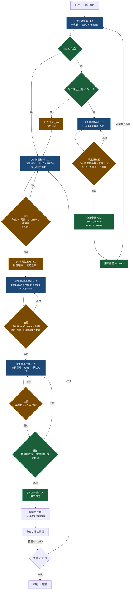

# 节点 1 · 判型与功能地图 · prompt 全文

- 对应：[DESIGN](../DESIGN.md) §2.3.1
- 状态：设计定稿，**待实现**（P2）
- 遵循 [README](README.md) 的四条约定

## 流程图

蓝＝LLM 步（L1/L2）｜黄＝确定性（校验 / 闭包 / 假设记录）｜绿＝闸与交互。
**每个蓝框后紧跟一个黄框**——即「prompt 负责生成得像，校验负责生成得对」。
配色**同时固定 `fill` 与 `color`**，不跟随主题——否则深色模式下主题的浅色文字会落在浅底上而不可读。



## 注入项清单

prompt 中所有 `{{...}}` 均为**运行时注入**，prompt 自身不含业务词汇。

| 占位符 | 来源 | 资产 |
|---|---|---|
| `{{one_liner}}` | 用户输入 | — |
| `{{clues}}` | 步 0 输出 | — |
| `{{question_bank_entries}}` | 问题库「前置」相位条目 | §4.2 |
| `{{question_dimensions}}` | 问题库维度表 | §4.2 |
| `{{lexicon}}` | 语义替换表 | §4.4 |
| `{{usage_nature_vocabulary}}` | 关系图谱：使用性质取值 | §4.3 |
| `{{usage_nature_descriptions}}` | 关系图谱：各使用性质说明 | §4.3 |
| `{{graph_closure}}` | 关系图谱：闭包全集（确定性产出） | §4.3 |
| `{{closure_with_decisions}}` | 步 3 结果（全集 + keep/drop） | — |
| `{{proposals}}` | 步 3 输出 | — |
| `{{rag_hits}}` | RAG：历史 spec 相似项（可选） | §4.6 |

---

## 步 0 · 试提取（L2）

```
你是需求前置分析。从用户的一句话需求中提取**可观察线索**，不做任何判断。

需求：{{one_liner}}

提取两类：
- form_clues：需求里**确实说了**的「给谁用 / 什么场合 / 什么终端」线索
- domain_clues：出现的**业务动作或对象**——用需求里的**原词**，不要改写成术语

规则：
- 只提取，不推断。需求没说的写 null，不要补。
- 不给结论（不要判断它是什么类型的产品）。
- 不引入需求里没有的词。

输出 JSON：
{
  "form_clues":   [{"clue": "...", "quote": "需求原文片段"}],
  "domain_clues": [{"clue": "...", "quote": "..."}],
  "missing": ["需求未提及、下游判型会需要的维度（只列维度名）"]
}
```

**期望输出**（"我要做个商城"）：

```json
{
  "form_clues":   [{"clue": "零售售卖场景", "quote": "商城"}],
  "domain_clues": [{"clue": "商城", "quote": "商城"}],
  "missing": ["买卖双方是谁", "卖什么", "是否真实收款", "是否管库存", "多少人用", "是否对公"]
}
```

**后置确定性校验**

| # | 检查 | 不过怎么办 |
|---|---|---|
| 1 | 每条 `quote` 须为 `one_liner` 的**子串** | 丢弃该条并重问 |

> `missing` 非空 → 进**步 1**；为空 → **直走步 2**。

---

## 步 1 · 前置拆问（L1）

```
你是需求澄清。用户只有一句话需求，信息不足以判型。请就**给定的维度**向用户提问，补充线索。

用户原话：{{one_liner}}
已提取线索：{{clues}}
待补维度（**只能问这些维度**）：
{{question_bank_entries}}
用户口语 ↔ 专业语对照：{{lexicon}}

规则：
- **用大白话问**，不出现任何专业词。
- 每问给：`question_id`（= 词条 id）、问法（一句自然话）、可选答案（有自然选项才给）、
  为什么问（给用户看的一句话）。
- **一次 ≤5 问**，只问信息量最大的；`missing` 里没有的不问。
- **绝不问技术方案**（不出现"要不要用 X""并发怎么办"这类）。
- 不问用户已经说过的事。

输出 JSON：
{
  "questions": [
    {"question_id": "<词条 id>",
     "ask": "<大白话问句>",
     "options": ["..."],
     "why": "<为什么问，给用户看>",
     "free_text_ok": true}
  ]
}
```

**期望输出**（"我要做个商城"）：

```json
{
  "questions": [
    {"question_id": "Q-BIZ-SENSITIVITY",
     "ask": "这个商城里买东西要真付钱吗？会不会涉及库存、名额这种『被别人抢走』的东西？",
     "options": ["要真付钱，也管库存", "要真付钱，但不管库存（比如虚拟商品）", "先不接真付款，只是展示"],
     "why": "这决定订单、付款、库存这些要不要认真做",
     "free_text_ok": true},
    {"question_id": "Q-SCALE-USERS",
     "ask": "大概多少人会用？是你自己、一个小团队，还是对外卖给别人？",
     "options": ["就我自己", "小团队内部用", "对外公开卖，可能会有人来买"],
     "why": "决定规模和要不要考虑人多的情况",
     "free_text_ok": true},
    {"question_id": "Q-SCALE-CONCURRENT",
     "ask": "会不会出现很多人同时抢同一件东西？",
     "options": ["不会，慢慢卖", "偶尔有热门款，会挤一下", "经常有抢购，会同时抢"],
     "why": "决定抢同一件东西时怎么处理",
     "free_text_ok": true}
  ]
}
```

**后置确定性校验**

| # | 检查 | 不过怎么办 |
|---|---|---|
| 1 | `question_id` ∈ 注入的「前置」条目集 | 丢弃该问（不许自造问题） |
| 2 | **问句不含专业词**——扫语义替换表**专业语侧**黑名单 | 丢弃该问并重问 |
| 3 | 问数 ≤ 5 | 截断至 5 |
| 4 | `question_id` **不与已答集重复** | 丢弃（**防空转**） |
| 5 | `ask` 与 `one_liner` 重叠率不超阈值 | 丢弃（不问已说过的） |

> **校验 2 是「用大白话问」的机器化落点**。反例：若产出「这个商城需要支持**高并发**吗？」→ `高并发` 命中黑名单 → 拦下重问。

**产出即 §3.1 中断契约**

```json
{"status": "needs_input", "questions": [...], "resume_token": "rt-xxxx"}
```

用户作答后，`answers` 以 `question_id → answer` 结构化回传，**并入线索**回到步 0。

### 前置拆问环（步 0 ⇄ 步 1）

- **上限 2 轮**（依据纪律「追问两次不动 → 记假设」）；
- 达上限仍有 `missing` → **强制前进**，缺口记**假设**入 `_log`，**不阻塞运行**；
- 轮次计数落运行元数据（续跑须知剩余轮次）。

---

## 步 2 · 判型初判（L1）

```
你是需求判型分析。依据线索，从给定词表中选出候选，给出依据与待验证项。

线索：{{clues}}

使用性质词表（**唯一可用取值来源**）：
{{usage_nature_vocabulary}}
各使用性质的说明与典型特征：
{{usage_nature_descriptions}}

问题维度词表（to_verify 只能用这里面的 id）：
{{question_dimensions}}

规则：
- **只能从词表取值**。词表没有合适的 → 放 `proposed` 提新词条（附依据），**不要硬套**。
- `evidence` 必须指回**线索原文**，不得是常识推断。
- `to_verify` 列出会**推翻或确认**该判型的事实维度，只能从问题维度词表选 id；
  **不得包含已经回答过的维度**。
- 状态一律 `initial`（初判），**不得输出定案**。
- 不确定就多给候选并排序，不要强行唯一。

输出 JSON：
{
  "candidates": [
    {"usage_nature": "<词表内的值>",
     "evidence": [{"clue": "...", "quote": "..."}],
     "confidence": "high|medium|low",
     "to_verify": ["<问题维度 id>"]}
  ],
  "proposed": [{"new_term": "...", "why": "...", "basis": "..."}]
}
```

**期望输出**（商城，前置拆问已答完）：

```json
{
  "candidates": [
    {"usage_nature": "交易",
     "evidence": [{"clue": "对外公开", "quote": "对外公开卖，可能会有人来买"},
                  {"clue": "真实资金流", "quote": "要真付钱，也管库存"}],
     "confidence": "high",
     "to_verify": ["Q-DEPLOY-SCENE"]}
  ],
  "proposed": []
}
```

**后置确定性校验**

| # | 检查 |
|---|---|
| 1 | `usage_nature` ∈ 注入词表（**不在即失败**，不许自造） |
| 2 | `to_verify` 的每个 id ∈ 问题维度词表 |
| 3 | **`to_verify` ∩ 已答集 == ∅**（防重复问） |
| 4 | `evidence.quote` 为线索原文子串 |

> `to_verify` 用 `Q#`，使**回边可确定性判定**：节点 2 答完后直接比对"答案 vs 初判"，不需 LLM 猜要不要回退。

---

## 步 3 · 地图推演（L1）

### 3a · 闭包展开（L0 · 确定性，非 prompt）

以判型候选为入口，按「归属 / 关联」边做**闭包**，得到候选**全集** `C`。图谱的角色到此为止——它负责**不漏**。

> **工程约束**：闭包可能数十项，一次 keep/drop 会走神 → **按域分批**，每批 ≤ N 项；域内决策与域间排序分两轮。

### 3b · 筛选与提案（L1）

```
你是功能地图精炼。图谱已给出候选全集，你的职责是**按需求线索筛选、排序、提案**。

需求线索：{{clues}}
判型初判：{{type_candidates}}

候选全集（**只能从这里面 keep/drop，不得增删**）：
{{graph_closure}}

用户口语 ↔ 专业语对照（仅用于理解线索）：
{{lexicon}}

规则：
- 对**每一项**给 keep 或 drop，并给 `reason`（指回具体线索）。**指不出依据就 drop**。
- 全部 keep 或全部 drop 都是可疑的——若确实如此，必须在 `notes` 说明为什么。
- `rank` 只对 keep 的项排（1 = 最相关）。
- 线索暗示、但全集里**确实没有**的模块 → 放 `proposals`，**不得**混进 keep/drop。
- **不做取舍**：keep 只表示"相关"，**不表示"必须做"**。

输出 JSON：
{
  "decisions": [{"id": "...", "keep": true, "reason": "<指回线索>", "rank": 1}],
  "proposals": [{"id_hint": "...", "kind": "域|模块", "name": "...", "parent": "...",
                 "basis": "<线索>", "proposed": true, "mvp_hint": "core|later"}],
  "notes": "全部 keep/drop 或其他异常时说明"
}
```

**期望输出**（商城，节选）：

```json
{
  "decisions": [
    {"id": "M-PRD-LIST",   "keep": true,  "reason": "线索『商城』+『对外公开卖』的浏览入口", "rank": 1},
    {"id": "M-ORD-SUBMIT", "keep": true,  "reason": "线索『要真付钱』直指下单", "rank": 1},
    {"id": "M-PAY-ONLINE", "keep": true,  "reason": "线索『要真付钱』", "rank": 1},
    {"id": "M-MKT-SECKILL","keep": true,  "reason": "线索『偶尔有热门款，会挤一下』", "rank": 4},
    {"id": "M-PAY-RECON",  "keep": false, "reason": "线索未提及对账需求"},
    {"id": "M-ORD-AFTERSALE","keep": false,"reason": "线索未提及售后"}
  ],
  "proposals": [
    {"id_hint": "NEW1", "kind": "模块", "name": "收货地址管理", "parent": "D-ORD",
     "basis": "线索『对外公开卖』+ 实物库存，暗示商品需寄送",
     "proposed": true, "mvp_hint": "core"}
  ],
  "notes": ""
}
```

**后置确定性校验**

| # | 检查 | 不过怎么办 |
|---|---|---|
| 1 | `decisions` 的 id 集合 **== 全集 `C`** | 漏 → 补跑；造 → 丢弃该项 |
| 2 | 每条 decision `reason` 非空 | 空的按 drop 并回问 |
| 3 | **闭包自洽**：keep 的项其 `parent` 也须 keep | 违反 → 自动补 keep 父节点 |
| 4 | `proposals[].proposed == true` | 强制改写 |
| 5 | 全 keep / 全 drop 时 `notes` 非空 | 回问 |

---

## 步 4 · 菜单生成（L1）

```
你是菜单呈现。把**候选全集**转成可勾选菜单。这是呈现层，不做取舍。

候选全集（含 keep/drop 建议，**必须全部出现，一项都不能少**）：
{{closure_with_decisions}}
提案项：{{proposals}}
历史 spec 相似项（可选，仅供参考）：{{rag_hits}}

规则：
- 按域分组，**每一项都要出现**——`keep` 只决定 `checked` 默认值与排序，**低相关项不得省略**。
- 每项：`域 · 模块` + 一句话说明（说**这个模块让用户能做什么**，不是技术描述）
  + mvp 建议 + 来源 + `relevance` + `checked`。
- `source`: `graph` | `proposed`——**proposed 必须标出**。
- `relevance`: `keep` 排前；`drop` 排后并**折叠但可见**。
- **不替用户勾选**：不排"推荐顺序"、不省略、不合并同类项。

输出 JSON：
{
  "groups": [
    {"domain": "...",
     "items": [{"id": "...", "label": "域 · 模块", "desc": "...",
                "mvp": "core|later", "source": "graph|proposed",
                "relevance": "keep|drop", "checked": true, "rag_similar": []}]}
  ]
}
```

**期望输出**（商城，节选）：

```json
{
  "groups": [
    {"domain": "订单", "items": [
      {"id": "M-ORD-SUBMIT", "label": "订单 · 结算下单",
       "desc": "选好东西后填地址、确认金额、生成订单",
       "mvp": "core", "source": "graph", "relevance": "keep", "checked": true, "rag_similar": []},
      {"id": "NEW1", "label": "订单 · 收货地址管理",
       "desc": "保存常用收货地址，下单时直接选",
       "mvp": "core", "source": "proposed", "relevance": "keep", "checked": true, "rag_similar": []},
      {"id": "M-ORD-AFTERSALE", "label": "订单 · 售后退款",
       "desc": "顾客申请退款或退货，运营处理",
       "mvp": "later", "source": "graph", "relevance": "drop", "checked": false, "rag_similar": []}]}
  ]
}
```

**后置确定性校验**

| # | 检查 |
|---|---|
| 1 | **菜单项集合 == 全集 `C` ∪ 提案**（**不多不少**） |
| 2 | 每项 `source` ∈ {`graph`, `proposed`} |
| 3 | `relevance == "drop"` 的项 `checked` 默认 `false` |

> **校验 1 是硬边界 1 的机器化检查**：**AI 不自动加功能，也不偷偷减功能**。`drop` 项必须出现——用户要能看到 AI 想筛掉什么、并勾回来。

---

## 步 5 · 用户闸（L0 · 非 prompt）

菜单交用户勾选 → **全部产出为初判态**，落 `.authoring.json` 初判索引，**不写任何交付文件**（`req.md` 由节点 2 汇总写入，`resolution.md` 由节点 8 写入）。
