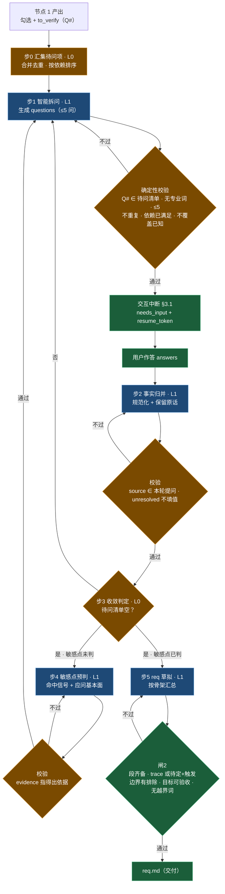

# 节点 2 · 事实澄清 · prompt 全文

- 对应：[DESIGN](../DESIGN.md) §2.3.2
- 状态：设计定稿，**待实现**（P2）
- 遵循 [README](README.md) 的四条约定

## 流程图

蓝＝LLM 步（L1/L2）｜黄＝确定性（校验 / 汇集 / 收敛判定）｜绿＝闸与交互。



**两段式轮次**：通用段 ≤4 轮 ／ 敏感点专项段 ≤2 轮，**独立计数**——共用预算会让长通用段饿死敏感点轮。

## 注入项清单

| 占位符 | 来源 | 资产 |
|---|---|---|
| `{{selected_functions}}` | 节点 1 勾选结果 | — |
| `{{facts_so_far}}` | 已收集事实集 | — |
| `{{pending_entries}}` | 待问清单（问题库「澄清」相位条目） | §4.2 |
| `{{lexicon}}` | 语义替换表 | §4.4 |
| `{{qa_pairs}}` | 本轮问答对 | — |
| `{{sensitivity_signals}}` | 问题库：敏感点信号组 | §4.2 |
| `{{four_dimensions}}` | 问题库：四基本面 | §4.2 |
| `{{req_skeleton}}` | 模板族：req 骨架 | §4.5 |

---

## 步 0 · 汇集待问项（L0 · 非 prompt）

三路来源合并：自身（问题库「澄清」条目）+ 上游（节点 1 的 `to_verify[Q#]`）+ 预判（步 4 产出）。

**确定性处理**：同一 `Q#` 只保留一次；按 `依赖` 拓扑排序。

---

## 步 1 · 智能拆问（L1）

```
你是需求澄清。已知用户要做的系统功能与部分事实，请就**待问清单**向用户提问。

已知：
- 用户原话：{{one_liner}}
- 功能清单：{{selected_functions}}
- 已收集事实：{{facts_so_far}}
- 待问维度（**只能问这些**，已按依赖排序）：{{pending_entries}}
- 用户口语 ↔ 专业语对照：{{lexicon}}

规则：
- **用大白话问**，不出现任何专业词。
- **一轮 ≤5 问**；优先问**依赖已满足**且**信息量最大**的。
- **绝不问技术方案**（不问"要不要用 X""怎么实现"）。
- **不问已知事实**。
- 每问：`question_id`、问法、可选答案、为什么问。
- 某维度**依赖未满足** → 本轮不问，留待后续轮。

输出 JSON：
{ "questions": [ {"question_id":"...", "ask":"...", "options":["..."], "why":"...", "free_text_ok":true} ] }
```

**期望输出**（商城，第 1 轮）：

```json
{
  "questions": [
    {"question_id": "Q-KEY-PEAK",
     "ask": "会不会有集中抢购的时候？比如限时特价一开，很多人一起来买？",
     "options": ["基本没有，平时慢慢卖", "偶尔有，但不至于挤爆", "经常有，会同时来很多人"],
     "why": "决定抢同一批货时怎么处理",
     "free_text_ok": true},
    {"question_id": "Q-INV-OVERSEL",
     "ask": "万一两个人同时买到最后一件，你希望怎么处理？",
     "options": ["绝对不能多卖，宁可让一个人买不到", "差一件半件可以事后补", "不太在意"],
     "why": "决定库存要怎么扣才不会出错",
     "free_text_ok": true},
    {"question_id": "Q-ORD-CANCEL-WINDOW",
     "ask": "顾客下单后一直不付钱，多久算放弃、可以把货放回去？",
     "options": ["半小时", "一小时", "一天", "不用管，让它挂着"],
     "why": "决定未付款订单什么时候释放",
     "free_text_ok": true}
  ]
}
```

**后置确定性校验**

| # | 检查 | 不过怎么办 |
|---|---|---|
| 1 | `question_id` ∈ 待问清单 | 丢弃该问 |
| 2 | **问句不含专业词**（语义替换表专业语侧黑名单） | 丢弃并重问 |
| 3 | ≤5 问 | 截断至 5 |
| 4 | 不与已答集重复 | 丢弃 |
| 5 | **依赖已满足**：`depends_on ⊆ 已答集` | 移出本轮，留待后续轮 |
| 6 | 不覆盖已收集事实 | 丢弃 |

> 校验 5 是节点 2 特有的——问题库条目除 `触发条件`（**是否适用**）外还有 `依赖`（**排序**）。二者不同：无触发 → **永远不问**；依赖未满足 → **暂不问**。

**产出即 §3.1 中断契约**（同节点 1）。

---

## 步 2 · 事实归并（L1）

```
你是事实归并。把用户对提问的回答归并成**结构化事实**。

提问与回答：{{qa_pairs}}
用户口语 ↔ 专业语对照：{{lexicon}}

规则：
- 每个回答归并成一条事实：`{dimension, value, source, quote, unresolved}`。
- 用语义替换表把口语**规范化**，但**保留原话**。
- 回答含糊/答不上 → 标 `unresolved: true`，**不要编**。
- 回答里出现**新的可追问线索** → 放 `followups`（附依据）。

输出 JSON：
{
  "facts": [{"dimension":"<问题维度 id>", "value":"...", "source":"Q-x", "quote":"<原话>", "unresolved":false}],
  "followups": [{"dimension":"...", "why":"..."}]
}
```

**期望输出**：

```json
{
  "facts": [
    {"dimension": "Q-KEY-PEAK", "value": "偶尔有集中抢购，但不至于挤爆",
     "source": "Q-KEY-PEAK", "quote": "偶尔有，但不至于挤爆", "unresolved": false},
    {"dimension": "Q-INV-OVERSEL", "value": "不可超卖，宁缺毋滥",
     "source": "Q-INV-OVERSEL", "quote": "绝对不能多卖，宁可让一个人买不到", "unresolved": false},
    {"dimension": "Q-ORD-CANCEL-WINDOW", "value": "半小时",
     "source": "Q-ORD-CANCEL-WINDOW", "quote": "半小时", "unresolved": false}
  ],
  "followups": [
    {"dimension": "Q-PEAK-SCALE", "why": "用户提到'偶尔集中抢购'，需知道量级才能定机制强度"}
  ]
}
```

**后置确定性校验**

| # | 检查 |
|---|---|
| 1 | `source` ∈ 本轮提问集 |
| 2 | `unresolved == true` 的条目**不得**填具体 `value` |
| 3 | `followups[].dimension` ∈ 问题维度表 |

> 事实集**不给 ID**——用 `source: Q#` 溯源即可，避免 ID 命名空间膨胀。

---

## 步 3 · 收敛判定（L0 · 非 prompt）

```text
待问清单空 ──否──▶ 回步1
      │
     是
      ├─ 敏感点未判 ──▶ 步4（产出并入待问清单，回步1）
      └─ 敏感点已判 ──▶ 步5
```

**两段独立计数**：通用段 ≤4 轮；敏感点专项段 ≤2 轮。达上限仍有未问项 → **强制前进**，剩余记假设入 `_log`。

---

## 步 4 · 敏感点预判（L1）

**放在收敛之后**——事实充分才判得准；敏感点问题集中成一轮专项；与节点 5 分工清晰（本节点判**有哪些信号**，节点 5 补**具体设计参数**）。

```
你是设计敏感点预判。依据功能清单与已知事实，判断哪些**敏感点信号**命中，
并为命中的信号列出必须问清的**基本面**。

功能清单：{{selected_functions}}
已知事实：{{facts_so_far}}

敏感点信号（**只能从这些里判**）：{{sensitivity_signals}}
四基本面：{{four_dimensions}}

规则：
- 逐个信号判命中与否；**命中必须给 `evidence`**（指回具体功能项 id 或事实键）。
  **指不出依据即判未命中**。
- 命中的信号，列出该信号必须问清的基本面维度（从四基本面选）。
- **不猜方案**：只判"需要问什么"，不给任何机制建议。

输出 JSON：
{
  "hits":   [{"signal": "...", "evidence": ["<功能项 id>"], "ask_dimensions": ["行为参数","后果容忍度"]}],
  "misses": [{"signal": "...", "reason": "..."}]
}
```

**期望输出**（商城）：

```json
{
  "hits": [
    {"signal": "资源竞争（库存被抢）",
     "evidence": ["M-MKT-SECKILL", "M-PRD-MGMT"],
     "ask_dimensions": ["量级与同时性", "后果容忍度", "精度"]},
    {"signal": "自动状态流转（订单超时）",
     "evidence": ["M-ORD-SUBMIT"],
     "ask_dimensions": ["行为参数", "精度"]}
  ],
  "misses": [
    {"signal": "延迟敏感副作用", "reason": "功能清单中无发送/释放类副作用"}
  ]
}
```

**后置确定性校验**：`hits[].evidence` 非空，且每个元素 ∈ 功能项 id ∪ 事实键。**指不出依据的命中一律退回**。

> 命中的信号 → 其 `ask_dimensions` 转为待问条目（**并入待问清单**），循环回到步 1 跑专项轮。

---

## 步 5 · req 草拟（L1）+ 闸 2

```
你是需求规格草拟。依据已收集事实，按给定骨架草拟 req。

事实集：{{facts}}
功能清单与勾选：{{selected_functions}}
骨架（**必含段，按此顺序**）：{{req_skeleton}}

规则：
- **只写事实支撑得了的内容**；无事实支撑的段落写"待定"并给触发条件。
- 边界段**至少一条"明确不做"**。
- 目标须**可验收**（不是形容词）；主流程 3–8 步。
- 不引入任何技术方案、产品名（DESIGN §1.4）。
- 每条结论尽量给 trace（→ Q#）。

输出 JSON：
{
  "sections": [{"name": "...", "content": "...", "traces": ["Q-x"]}],
  "open_questions": [{"question": "...", "trigger": "..."}]
}
```

**后置确定性校验（= 闸 2）**

| # | 检查 | 判定侧 |
|---|---|---|
| 1 | 骨架必含段齐备 | 确定性 |
| 2 | 每段能 trace 到事实 **或** 显式"待定 + 触发条件" | 确定性 |
| 3 | 边界含 ≥1 条排除项 | 确定性 |
| 4 | 目标可验收（非形容词） | **判断**（`CR2`） |
| 5 | 无越界词 | 确定性（`CR4`） |

**通过 → `req.md` 落目标项目 `specs/`**（节点 2 是唯一写入者）。
