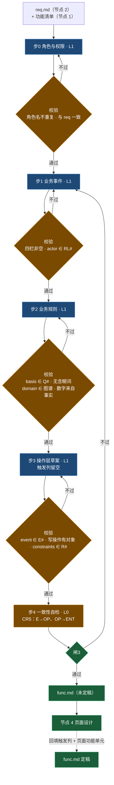

# 节点 3 · 功能规格 · prompt 全文

- 对应：[DESIGN](../DESIGN.md) §2.3.3
- 状态：设计定稿，**待实现**（P2）
- 遵循 [README](README.md) 的四条约定

## 流程图

蓝＝LLM 步（L1）｜黄＝确定性（校验 / 自检）｜绿＝闸与产出。



**ID 分配**：`RL#` / `E#` / `R#` / `OP#` 一律由**运行体按顺序分配**——LLM **不产出 ID**（契合 DESIGN §1.6「分配即冻结」）。

## 注入项清单

| 占位符 | 来源 |
|---|---|
| `{{req_roles}}` | `req.md` 角色段 |
| `{{req_main_flow}}` | `req.md` 主流程段 |
| `{{selected_functions}}` | 节点 1 勾选结果 |
| `{{facts}}` | 节点 2 事实集 |
| `{{sensitivity_hits}}` | 节点 2 敏感点预判命中项 |
| `{{domains}}` | 关系图谱域节点（§4.3） |
| `{{entities_hint}}` | 已有数据对象候选（可选） |

---

## 步 0 · 角色与权限（L1）

```
你是角色与权限整理。依据需求里的角色与功能清单，整理出系统的**角色**及其**权限要求**。

需求角色：{{req_roles}}
功能清单：{{selected_functions}}

规则：
- 角色与需求保持一致；**不要发明需求里没有的角色**。
- 权限要求用**业务语言**描述"能做什么、不能做什么"（如"无权改价、无权资金审批"）。
- 用户自己的原话里若已说明分工，照实收录。

输出 JSON：
{ "roles": [ {"name":"...", "permissions":["..."], "note":"..."} ] }
```

**期望输出**：

```json
{
  "roles": [
    {"name": "顾客", "permissions": ["浏览", "登录", "下单", "付款", "查单", "申请售后"], "note": "须注册才能下单"},
    {"name": "运营", "permissions": ["商品维护", "订单处理", "发货", "售后执行"], "note": "无权改资金级事项"},
    {"name": "店主", "permissions": ["全部", "资金审批"], "note": "运营的角色是其子集"}
  ]
}
```

**校验**：角色名不重复；与 `req_roles` 一致（新增须有据）。→ 分配 `RL#`

---

## 步 1 · 业务事件（L1）

```
你是业务事件切分。把功能清单切成**业务事件**——一次业务上完整的、有成功/失败的事。

功能清单：{{selected_functions}}
需求主流程：{{req_main_flow}}
已收集事实：{{facts}}

规则：
- 每事件给：`name`、**谁触发**、**前提**、**成功结果**、**失败/异常**。
- 四栏**都要有**；确实无前提/无异常的写"无"，**不要留空**。
- 事件是**业务粒度**（"顾客下单"），不是技术粒度（"调用支付接口"）。
- **不写实现**、不写技术方案。

输出 JSON：
{ "events": [ {"name":"...", "actor":"<RL 角色名>", "precondition":"...", "success":"...", "failure":"..."} ] }
```

**期望输出**（节选）：

```json
{
  "events": [
    {"name": "顾客下单", "actor": "顾客",
     "precondition": "已登录、商品在售、库存可锁",
     "success": "生成待支付订单，金额快照确定，库存被预占",
     "failure": "库存不足/商品下架/金额算不出 → 不生成订单"},
    {"name": "在线付款", "actor": "顾客 / 收款渠道回调",
     "precondition": "订单处于待支付",
     "success": "收款成功且金额核验一致 → 订单转为已支付",
     "failure": "取消/失败 → 仍待支付；金额不符 → 拦截告警"}
  ]
}
```

**校验**：四栏均非空；`actor` ∈ `RL#`。→ 分配 `E#`

---

## 步 2 · 业务规则（L1）★ 核心

```
你是业务规则推导。从已收集事实与设计敏感点，推导系统必须遵守的**业务规则**。

事实集：{{facts}}
功能清单：{{selected_functions}}
已识别敏感点：{{sensitivity_hits}}
业务事件：{{events}}
域词表（domain 只能用这里面的）：{{domains}}

规则：
- 每条规则是**机器可判的单义句**——换两个实现者不会得出不同结果。
- **禁止含糊词**：尽量 / 合理 / 必要时 / 视情况 / 适当 / 大概。
- 每条规则给 `basis`：指回**事实（Q#）或不变式**。**指不出依据的规则不得写**。
- 规则里的数字/阈值/窗口**必须来自事实**，**不得自己填**；事实没有的 → 进 `open`。
- 域写在 `domain` 列，**不写进 ID**。

输出 JSON：
{
  "rules": [{"domain":"<域节点 id>", "label":"<短标签，非身份>", "text":"<单义句>", "basis":["Q-x"], "kind":"约束|不变式|流程"}],
  "open":  [{"about":"...", "need":"还需要什么事实"}]
}
```

**期望输出**：

```json
{
  "rules": [
    {"domain": "D-INV", "label": "防超卖",
     "text": "任意售卖路径不得使规格售出超其可售库存；下单即原子预占，未付过期释放，支付成功才实扣。",
     "basis": ["Q-INV-OVERSEL"], "kind": "不变式"},
    {"domain": "D-ORD", "label": "未付释放窗口",
     "text": "待支付订单超过 30 分钟未付款，自动取消并释放锁货。",
     "basis": ["Q-ORD-CANCEL-WINDOW"], "kind": "流程"},
    {"domain": "D-PAY", "label": "回执幂等",
     "text": "一笔订单至多支付成功一次；重复的收款回执不二次生效。",
     "basis": ["Q-BIZ-SENSITIVITY"], "kind": "约束"}
  ],
  "open": [
    {"about": "超时取消的准点精度", "need": "用户未说明是否要求秒级准点"}
  ]
}
```

**后置确定性校验**

| # | 检查 | 依据 |
|---|---|---|
| 1 | `basis` 非空且每个 ∈ `Q#` 集 | **`CR3` 有依据**——指不出依据即拒 |
| 2 | **含糊词黑名单扫描**（尽量 / 合理 / 必要时 / 视情况 / 适当 / 大概…） | **`CR2` 可判的机器化落点** |
| 3 | `domain` ∈ 图谱域节点 | 词汇层校验（§1.6） |
| 4 | 规则中出现的阈值数字能在事实里找到 | 防 LLM 自己编数字 |

> 反例：若写出「库存不足时**尽量**拦截」→ `尽量` 命中黑名单 → 退回重写。

→ 分配 `R#`

---

## 步 3 · 操作层草案（L1）

```
你是操作层整理。把业务事件与规则落成**操作**——每个操作是一次对业务对象的读写改。

业务事件：{{events}}
业务规则：{{rules}}
已有数据对象候选：{{entities_hint}}

规则：
- 每个操作给：名称、**归属事件**、**对哪些业务对象做什么**（读/写/改 + 涉及哪些属性）、
  **受哪些规则约束**、**需要哪个权限**。
- 粒度标准：**能直接落端点语义、能推出数据流**。
- **不做实现**：不写接口、不写技术方案。
- **触发（哪屏的哪个动作）留空**——待页面设计回填。

输出 JSON：
{
  "operations": [
    {"name":"...", "event":"<事件名>",
     "objects":[{"entity":"...", "access":"读|写|改", "attrs":["..."]}],
     "constraints":["<规则 label>"], "permission":"<RL 角色名>"}
  ]
}
```

**期望输出**：

```json
{
  "operations": [
    {"name": "提交订单", "event": "顾客下单",
     "objects": [{"entity": "订单", "access": "写", "attrs": ["顾客", "金额快照", "状态"]},
                 {"entity": "库存台账", "access": "改", "attrs": ["当前锁定数"]}],
     "constraints": ["防超卖"], "permission": "顾客"},
    {"name": "接收收款回执", "event": "在线付款",
     "objects": [{"entity": "收款单", "access": "写", "attrs": ["渠道回执唯一键", "状态"]},
                 {"entity": "订单", "access": "改", "attrs": ["状态"]}],
     "constraints": ["回执幂等"], "permission": "系统"}
  ]
}
```

**后置确定性校验**：① `event` ∈ `E#` ② **写操作必须有业务对象**（`CR5` 的 `OP → ENT`）③ `constraints` ∈ `R#`。→ 分配 `OP#`

---

## 步 4 · 一致性自检 + 闸 3（L0 · 非 prompt）

**自检**：`CR5` 边检查——`E → OP`（每事件 ≥1 操作）、`OP → ENT`（每写操作落到实体）。

**闸 3**

| # | 条件 | 判定侧 |
|---|---|---|
| 1 | 每事件四栏齐备 | 确定性 |
| 2 | 每条规则有 `basis` 且**无含糊词** | 确定性 |
| 3 | 每写操作有业务对象 | 确定性 |
| 4 | `E → OP` 边完整 | 确定性（`CR5`） |
| 5 | `open` 项带补问触发 | 确定性 |

**通过 → `func.md` 落目标项目 `specs/`，状态为「未定稿」**——待节点 4 回填操作层「触发(屏.动作)」列与「页面功能单元」表后才定稿。
