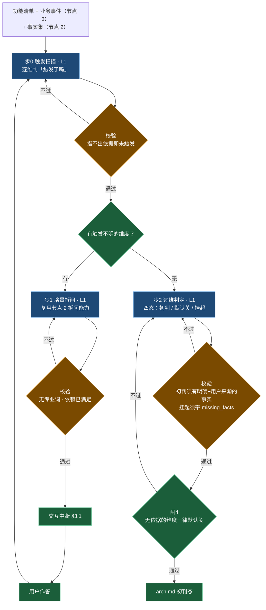

# 节点 4 · 形态与架构初判 · prompt 全文

- 对应：[DESIGN](../DESIGN.md) §2.3.4
- 状态：设计定稿，**待实现**（P2）
- 遵循 [README](README.md) 的四条约定

## 流程图

蓝＝LLM 步（L1）｜黄＝确定性（校验）｜绿＝闸与交互。



## 注入项清单

| 占位符 | 来源 |
|---|---|
| `{{architecture_dimensions}}` | 问题库「架构」相位条目（§4.2） |
| `{{selected_functions}}` | 节点 1 勾选结果 |
| `{{events}}` | 节点 3 业务事件 `E#` |
| `{{facts}}` | 节点 2 事实集 |
| `{{lexicon}}` | 语义替换表（§4.4） |
| `{{triggered_dims}}` | 步 0 判定为已触发的维度 |
| `{{question_dimensions}}` | 问题库维度表（`to_verify` 取值域） |

**★ 维度本身来自问题库资产**——系统不内置任何架构维度。

---

## 步 0 · 触发扫描（L1）

```
你是架构维度触发扫描。对每个架构维度，判断**它在这个项目里是否被触发**。

功能清单：{{selected_functions}}
业务事件：{{events}}
已收集事实：{{facts}}
架构维度（**只能判这些**）：{{architecture_dimensions}}

规则：
- 每个维度给 `triggered` 与 `basis`（指回**具体事实键或事件名**）。
- **指不出依据 = 未触发**——不要凭"一般来说"给触发。
- **`basis` 不许用软事实**——若依据里**只有** `certainty=含糊` 或 `origin≠用户` 的事实，
  判 `triggered: "unknown"`，**不要判触发**（通则 ⑥）。
- 判不了（事实不足）→ `triggered: "unknown"`，交增量拆问。
- **不给方案、不给结论**——这一步只判"要不要管这一维"。

输出 JSON：
{ "triggers": [ {"dimension":"<维度 id>", "triggered": true|false|"unknown", "basis":["<事实键或事件名>"], "why":"..."} ] }
```

**期望输出**（商城）：

```json
{
  "triggers": [
    {"dimension": "单元拓扑", "triggered": true,
     "basis": ["M-OPS-ORDMGMT", "Q-SCALE-USERS"], "why": "运营与顾客是两拨人、诉求不同"},
    {"dimension": "认证", "triggered": true, "basis": ["E1"], "why": "存在顾客注册/登录事件"},
    {"dimension": "授权", "triggered": true, "basis": ["Q-BIZ-SENSITIVITY"], "why": "涉及资金，需区分权限"},
    {"dimension": "服务拓扑", "triggered": "unknown", "basis": [], "why": "事实未提及是否多团队分开改"},
    {"dimension": "多语言", "triggered": false, "basis": [], "why": "事实未提及非中文用户"},
    {"dimension": "公开 API", "triggered": false, "basis": [], "why": "事实未提及程序化访问"}
  ]
}
```

**后置确定性校验**

| # | 检查 |
|---|---|
| 1 | `dimension` ∈ 注入的维度集 |
| 2 | `triggered == true` 时 `basis` 非空 |
| 3 | `triggered == "unknown"` 时 `why` 非空 |

---

## 步 1 · 增量拆问（L1）

**与节点 2 步 1 同一套能力**——只是消费相位换成「架构」。prompt 同 [node-02.md](node-02.md#步-1--智能拆问l1)，`{{pending_entries}}` 换为**触发不明的架构维度条目**。

产出同样是 §3.1 中断契约；校验沿用节点 2 那套（无专业词 · ≤5 问 · 依赖已满足 · 不重复）。

---

## 步 2 · 逐维判定（L1）

**四态**——`触发` 与 `可判` 是两件事：

| 状态 | 条件 | 处置 |
|---|---|---|
| `初判` | 触发命中 **且** `basis` 含 **≥1 条** `certainty=明确` 且 `origin=用户` 的事实 | 给结论 + `to_verify` + `escalate_when` |
| `默认关` | **指不出触发依据** | 记 `触发=X`，不展开 |
| **`挂起`** | **触发命中，但事实不足 / 含糊 / 来自兜底** | **不给结论**，必须给 `missing_facts` |

```
你是架构判定。对每个**已触发**的维度，判定它现在**能不能给出结论**。

已触发维度及依据：{{triggered_dims}}
事实集（**注意每条事实的 certainty / origin**）：{{facts}}
业务事件：{{events}}
问题维度表（to_verify 只能用这里面的 id）：{{question_dimensions}}

规则：
- 每条给 `status`（三选一）、`conclusion`、`basis`、`to_verify`、`escalate_when`。
- **`初判` 的门槛**：`basis` 里**至少 1 条** `certainty=明确` 且 `origin=用户` 的事实。
  **含糊的事实与兜底补的事实都不能当依据用**。
- **`挂起` 不等于 `默认关`**——前者是"这一维相关、但我现在判不了"，必须给
  `missing_facts`（缺哪些事实）；后者才是"这一维不相关"。
- 结论写**机制类别**（如"需原子缓存类语义的扣减"），**不写具体产品名**；
  确要举例时写进 `suggested_example`（**非规范**字段）。
- **不得假设任何底座存在**。

输出 JSON：
{
  "decisions": [
    {"dimension":"...", "status":"初判|默认关|挂起", "conclusion":"...",
     "basis":["Q-x"], "to_verify":["Q-y"], "escalate_when":"...",
     "missing_facts":["<status=挂起 时必填>"],
     "suggested_example":"<可选，非规范>"}
  ]
}
```

**期望输出**：

```json
{
  "decisions": [
    {"dimension": "单元拓扑", "status": "初判",
     "conclusion": "顾客侧与运营侧为两个访问单元，共享业务后端",
     "basis": ["M-OPS-ORDMGMT", "Q-SCALE-USERS"],
     "to_verify": ["Q-DEPLOY-SCENE"],
     "escalate_when": "两单元出现独立发布节奏"},
    {"dimension": "服务拓扑", "status": "默认关",
     "conclusion": "单体起步",
     "basis": [], "to_verify": [],
     "escalate_when": "多团队分开上线，或各部分量级差异巨大"}
  ]
}
```

**后置确定性校验（= 闸 4）**

| # | 检查 | 依据 |
|---|---|---|
| 1 | `status` ∈ {`初判`, `默认关`, **`挂起`**} | 枚举 |
| 2 | `status == "初判"` 时 `basis` 非空 | **`CR3` 有依据**——无依据一律 `默认关` |
| 3 | `conclusion` **不含产品名** | **§1.4 越界判据的机器化落点**（`suggested_example` 字段除外） |
| 4 | `to_verify` ∈ 问题维度表 | 词汇层校验 |
| 5 | `escalate_when` 非空 | 升级触发必填 |
| 6 | 维度覆盖完整（§2.2 架构组全集，无一遗漏） | 防漏维 |
| **7** | **`status == "初判"` 时 `basis` 至少含 1 条 `certainty=明确` 且 `origin=用户` 的事实** | **通则 ⑥——"依据够不够硬"的机器化落点** |
| **8** | **`status == "挂起"` 时 `missing_facts` 非空** | 挂起必须说清缺什么 |

> 校验 3 是本节最实的一条：把 §1.4 分层（机制类别规范 / 产品名非规范）**落成可扫的检查**——产品名只能出现在 `suggested_example` 里。

**通过 → `arch.md` 初判态落目标项目 `specs/`**，待节点 6 复核定稿。
